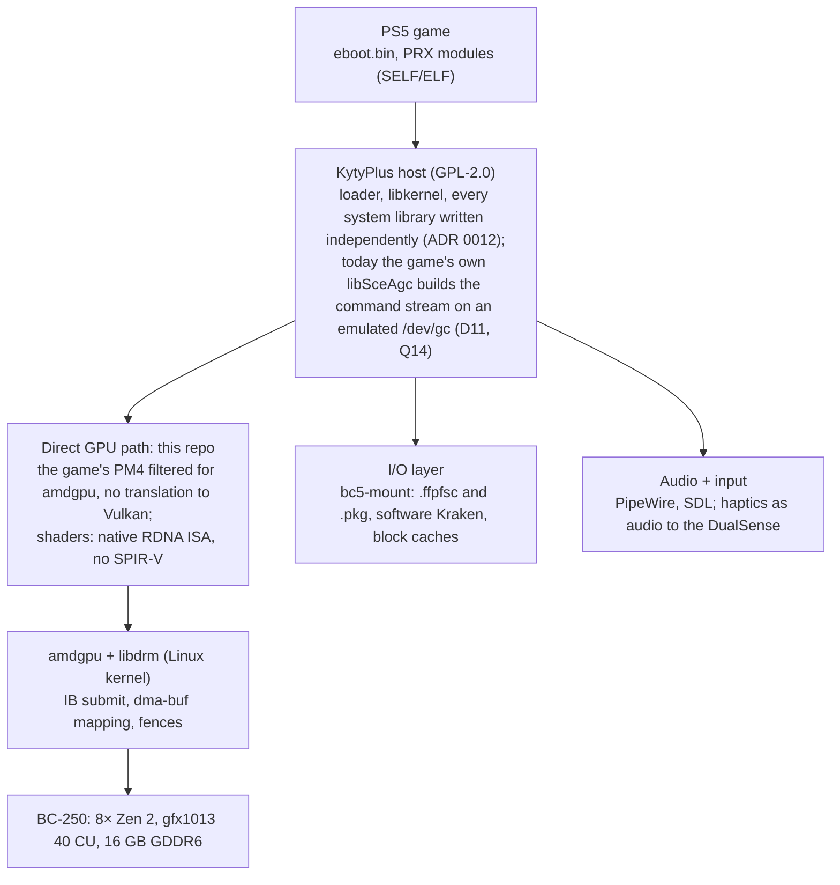

# BC5

**Run PlayStation 5 games on the AMD BC-250.**

BC5 is a user-space host for PS5 titles on the AMD BC-250 under Linux. The BC-250 is a mining board built around the same APU family as the PS5: a Zen 2 CPU, a `gfx1013` GPU and 16 GB of unified GDDR6 (F1, F13). Three parts make it work:

- **[KytyPlus](https://github.com/Coder787-source/KytyPlus)** (GPL-2.0), the emulator BC5 is built on: it loads the game's own code and provides the loader, the kernel, audio and input.
- **A direct GPU path**, this repository's `backend/`: the BC-250's GPU is the same shader target as the console's (F1, F63), so the game's own command buffers and its native RDNA shaders go to the GPU through Linux's `amdgpu` driver, filtered for its command processor but not translated to Vulkan (ADR 0005, ADR 0006, F37).
- **System libraries written independently.** Every PS5 system library a title calls is a stand-in written in the host from public symbol names and the title's own calls, following KytyPlus's model. BC5 uses no PS5 firmware and no system-software dump, and never will (ADR 0012, HANDOFF D18). The repository contains no Sony material.

Two tools come with it: `bc5-mount` reads PS5 game dumps and packages as a read-only directory, and `bc5-agc` decodes GPU command streams.

> **Status: research / alpha.** One game, ASTRO BOT, is fully playable in the maintainer's judgement (F85). A second title runs from its package through its menus, saves, loads and opening into gameplay (F207, F212). BC5 is built and tuned for the BC-250 alone (F63). You need your own console and your own game dumps (see [Legal](#legal)).

## Status

Every number below has its experiment under [`experiments/`](experiments/) and its finding (F1, F2, …) in [`docs/HANDOFF.md`](docs/HANDOFF.md) §2. All of it was measured on one BC-250 with the maintainer's own copies of the games, as of 2026-10-19.

| Game | Read from | State | Frame rate |
| --- | --- | --- | --- |
| ASTRO BOT | `.ffpfsc` dump, through `bc5-mount` | **Playable.** Intro, menus, every level the maintainer has played; controller with motion, haptics and adaptive triggers; saves (F52–F60, F78–F80, F85). The 3D resolution is chosen live from the settings menu (F101, F102) | first level 59–60 fps at 3328×1872, 57 at native 4K (F100); a later level 46.5 (F126); the water level 40–51 (F64, F137) |
| A second title (not named here) | PS5 debug package (`.pkg`), through `bc5-mount` | **Menus, saves, load, the opening, gameplay.** Intro and menus with sound and complete text (F165, F168, F172, F204); settings and save slots kept between starts, dated, under the title's own ID, deletable (F189–F194, F205); *Continue* loads a save to gameplay (F212); New Game plays its opening through to gameplay (F199, F206, F207). Known gaps: its ray-traced reflections are off — the reflection traversal and the BVH compaction that feeds it are skipped until the geometry-engine fault behind them is understood (F173, F207, F208); its ATRAC9 voices are silent (F200); the AnyPS5 ports of 2026-10-19 are not yet verified on the box (F214–F217) | intro 29 fps, the title's own limit (F168); menus 41–50 (F168, F204); gameplay a variable 30–42 against the 60 it asks for, because the render thread spends three quarters of its time in the host's per-submission path (F210); with submission chains across the game thread's ioctls, not yet in the play settings, the night scene runs at 45 flips/s instead of 33 (F218) |
| Any other game | | Untested. A title that calls a system library the host has no stand-in for stops there | |

Latest (2026-10-19):

- **No firmware, by decision** (ADR 0012): the project will not take the RPCSX road of booting the console's system modules; every system library is written in the host. The last two Sony modules still loaded from a game dump's `fakelib/`, `libSceAgc` and `libSceAgcDriver`, are to be replaced by an independently written driver (HANDOFF Q14).
- The second title's opening and gameplay: the hang 90 s in was the host leaking the AMM automatic pool (F206, fixed) and one BVH compaction dispatch whose output makes the geometry engine read from address 0 (F207, F208; skipped). Its speed-ups and slow-downs are frame-time changes from the host's submission cost (F210); submission chains, first per ioctl (F213) and then across the game thread's ioctls (ADR 0010 §A/§B, experiment 0165), take the night scene from 33 to 45 flips/s and the kernel submissions from 4,463 to 1,658 a second; off by default until the maintainer puts them in the play settings (F218). The menu artefact was GPU state inherited from the desktop's work on the same ring; a register-state prefix removes it (F204).
- Four library behaviours ported from AnyPS5 (GPL-2.0): rumble without an audio sink, NpManager callbacks, NpTrophy2 exports, SaveData search (F214–F217; [`docs/ports/anyps5-review.md`](docs/ports/anyps5-review.md)).
- A build-from-scratch script (`tools/scripts/bc5-build.sh`) and, in progress in another session, an emulator window with a menu bar (ADR 0011, experiment 0164).


*2026-10-01, experiment 0016, run 79: the first recognisable frame through the direct path. These screenshots are the only game output in this repository.*

## How it works



The host hands the console-format command stream to BC5's backend at the `/dev/gc` boundary (F12, F18, F19). The backend filters it for `amdgpu`, dropping or rewriting the packets the BC-250's command processor must not run (ADR 0005, F27); supplies what the console's command processor does and `amdgpu`'s does not — the context-state stack, cross-queue label hand-overs, waits for CP DMA (F34–F42); maps the game's memory 1:1 into the GPU's address space as dma-bufs of the host's own backing files (ADR 0006, F40, F55); and submits with jobs in flight on the GFX ring, with the title's asynchronous compute on the BC-250's compute rings (ADR 0009, F178, F181), cross-queue waits left to the GPU where a job already on the ring will satisfy them (F109, F117) and graphics pieces behind a full-state prefix for the rest (ADR 0008, F137, F170).

What BC5 is not:

- **Not a firmware boot, and not a system-software emulator.** The PS5 boot chain cannot run on a BC-250, and BC5 loads no system-software dump either way (ADR 0012). Everything is user space on a normal Linux kernel.
- **Not a new emulator.** BC5 extends KytyPlus with the GPU path, the patch set in [`backend/kytyplus-patches/`](backend/kytyplus-patches/) and the tools.
- **Not a PC emulator.** The games' shaders use instructions no GPU you can buy has in this combination; the untranslated path needs the console's own silicon, which the BC-250 carries (F63).
- **Not a piracy tool.** See [Legal](#legal).

## Build

Requirements: an AMD BC-250 with the community core and CU unlocks (8C/16T, 40 CU) and the dynamic VRAM split in BIOS (HANDOFF D8, D13); Linux with a Mesa/RADV that knows gfx1013 (the dev box runs Bazzite with a KDE Wayland session); `ttm.pages_limit` raised on the kernel command line so `amdgpu`'s GTT domain holds the game's memory (D12: 13 GiB for a 16 GB board); the `udmabuf` device (ADR 0006); a DualSense on USB. Everything is built inside an Ubuntu 26.04 distrobox so the host system stays untouched (`CLAUDE.md`, "Machine context").

One script does the rest, idempotently: it clones or fast-forwards this repository into `~/src/bc5`, clones KytyPlus at `f266548` into `~/src/KytyPlus` and applies the patch, then builds the backend library and `kyty_emulator` inside the `ubuntu` container. A re-run only redoes what changed; local changes in either checkout are saved to a diff file, never dropped.

```bash
bash ~/src/bc5/tools/scripts/bc5-build.sh
```

The emulator is `~/bc5-work/kytyplus-build/src/kyty_emulator`; the previous one is kept as `kyty_emulator.prev`. `BC5_BUILD_MOUNT=1` also builds `bc5-mount`; `BC5_BUILD_KEEP_KYTY=1` builds the KytyPlus tree as it is. The script's header lists every knob, and [`tools/scripts/bc5-build.sh`](tools/scripts/bc5-build.sh) is the reference for the exact CMake flags.

## Run

Games are started from launcher scripts on the dev box, one per title kind, behind desktop shortcuts: `play-astro.sh` for a `.ffpfsc` dump and `play-pkg.sh` for a PS5 package. A launcher mounts the image read-only with `bc5-mount`, exports the shared settings of `bc5-run.env` plus the title's own switches (HANDOFF D15), and runs the emulator; the title's own switches are the ones the experiments established, every one described in [`backend/kytyplus-patches/README.md`](backend/kytyplus-patches/README.md). The last committed copies of `play-pkg.sh`, `play-astro.sh` and `play-any.sh` are in [`experiments/0177-lean-build/`](experiments/0177-lean-build/).

**Direct mode sends raw command buffers to the GPU: a bad one can hang the display or reset the machine (F25, F27, F28). Save your work before every run.** Set `BC5_DIRECT_STAGE=maponly` once to see that the build, the mount and the mapping work without a submission, then `all`.

Today the host still loads two Sony modules from your own game dump, `libSceAgc.sprx` and `libSceAgcDriver.sprx` (a `.ffpfsc` dump has them in `fakelib/`; a package has none, so they come from another of your dumps), through `SHADPS4_SYSMODULES_PACK_DIR`. That is game-dump content, not firmware, and it is being phased out in favour of a driver written in the host (ADR 0012, HANDOFF Q14).

**An emulator window with a menu bar** is being finished in another session (ADR 0011, experiment 0164); the lines below are that session's and describe the state on `main`.

**The window has a menu bar** (ADR 0011, experiment 0164): *File* (Open game image..., Open package (.pkg)..., Recent, Close session, Quit), *Emulation* (Pause/Resume, Restart, Settings..., Fullscreen) and *Help* (About). `kyty_emulator --menu` opens the window with no game and a launcher page; during play F1 or the pad's PS button shows and hides the bar (the game gets no input while it is up). It is drawn into the game's frame, so it works fullscreen, with the mouse, the keyboard and the pad (d-pad or left stick, Cross, Circle, Square jumps to the bar). The host never mounts anything: *Open* writes the chosen path to `$KYTY_BC5_MENU_DIR/choice.txt` and exits with code 76, *Close session* exits with 77, *Restart* with 75, and a launcher script does the rest. On the dev box that is `~/bc5-work/play-any.sh` (the *BC5 emulator* desktop entry, [`experiments/0164-window-menu/play-any.sh`](experiments/0164-window-menu/play-any.sh)): it runs the empty window with the settings above, hands a `.pkg` to `play-pkg.sh` and a `.ffpfsc` to `play-astro.sh` — the mount, the system-module pack and the title's own switches stay in those scripts — and comes back to the empty window on 77.

*Emulation > Logging: on/off* is the session's logging switch: off, the host writes nothing — not the direct path's journal and dumps (`BC5_GC_DUMP_DIR`, `BC5_DIRECT_TIMING`, `BC5_DIRECT_FRAME_PROFILE`), not `LOGF` or the guest's printf, none of the stderr traces (`KYTY_BC5_*_TRACE`, `BC5_DIRECT_*_TRACE`), not the drop tally or the dispatch journal. It is one atomic flag every writer checks first, toggled live from the menu; `BC5_LOGGING=0` in the environment (the settings file, say) starts a session with it off. The journal itself costs nothing visible (experiment 0162: 42.1 against 41.3 fps), so the switch is for the traces and for peace of mind.

**A lean build** (experiment 0177) sits next to the normal one: `bc5-build.sh` also builds `~/bc5-work/kytyplus-build-lean` with `-DKYTY_BC5_LEAN=ON`, the same emulator with every trace, journal, dump, counter, profiler zone and recorder compiled out and the diagnostic variables removed from the environment at start. The *BC5 emulator (lean)* desktop entry runs `play-any.sh` with `BC5_LEAN=1`; the launchers then start the lean binary, set none of the measurements, start no sampler, and log to `play-*-lean-last.log`. It cannot report a frame rate: play with it, measure with the normal build. The launchers with this switch are in [`experiments/0177-lean-build/`](experiments/0177-lean-build/).

In the game window, F2 opens a settings menu that binds controls, picks the 3D resolution for ASTRO BOT and saves to the input file (HANDOFF D14, F101). Leave that resolution at its first step (4K UHD, scale 1.0) for other titles: the second title paces its frames by the same GPU time and runs at half rate at the "1440p class" step (F237). `KYTY_BC5_INPUT_CONFIG=<file>` names that file; [`backend/kytyplus-patches/input.example.cfg`](backend/kytyplus-patches/input.example.cfg) lists the names.

If it does not work: submissions failing with out-of-memory in the journal mean the GTT limit is not raised or another program holds GPU memory (F44); input that drops out for seconds is the controller's USB link (F61, F77); a picture that freezes for a few seconds and comes back is a submission that timed out and a device the host reopened (F74); a machine reset is the risk named above.

## Layout

```
README.md            this file, the public summary
CLAUDE.md            standing instructions and the hard rules
docs/
  HANDOFF.md         research state: findings F1–F218 with sources, open questions, decisions
  PHASES.md          the gated roadmap (phases 0a–3 passed; 0b and 4 retired by ADR 0012)
  console-vs-host.md what the console does, what the host does instead, and where it can do it the console's way
  formats/           derived format notes: ffpfsc, ps5pkg, agc, ajm-opus
  decisions/         ADRs 0001–0012, one decision each
  ports/             reviews of projects whose code can be ported (AnyPS5)
tools/
  bc5-mount/         Rust: .ffpfsc and .pkg as a read-only directory (FUSE), fixtures, tests
  bc5-agc/           Rust: PM4/AGC command-stream decoder and report
  scripts/           bc5-build.sh
backend/             C++20: the direct path (bc5::direct::Device: policy filter, state trackers,
                     dma-buf mappings, submission); kytyplus-patches/ the patch against KytyPlus
experiments/         one directory per experiment, 0001–0165: question, setup, result, verdict,
                     raw logs; never edited after the verdict, a new one is added instead
```

## Hard rules

From [`CLAUDE.md`](CLAUDE.md); they bind every contributor and every tool run against this repository.

1. **No Sony material in the repo, ever**: no firmware, system modules, keys, SDK headers, `.self`/`.prx` from a console, game dumps, containers of real games, decrypted binaries, or links to any of these. Test data is synthetic or open-source homebrew.
2. **Never download, search for or link to game dumps, torrents, warez or "backports".** The project is explicitly anti-piracy; reference public research code only.
3. **The leaked PS5 boot ROM keys are off-limits.**
4. **Hardware facts cite a source**: a public repo file, a public AMD document, or an experiment under `experiments/`. Anything unsourced is a `TODO(verify)`, not a fact.
5. **Raw GPU submission can hang the machine.** Everything that submits is behind an explicit switch, default off, and never runs in CI or tests.

## Where to read next

- [`docs/HANDOFF.md`](docs/HANDOFF.md): the findings (§2), the open questions with their plans (§3), the architecture (§4), related projects (§6) and the decisions (§7).
- [`docs/console-vs-host.md`](docs/console-vs-host.md): the inventory of what the host still does differently from the console, ordered by what it costs the player (experiment 0162).
- [`docs/PHASES.md`](docs/PHASES.md): the roadmap with its gates and the recorded deviations.
- [`docs/decisions/`](docs/decisions/): why things are the way they are, one ADR each; [0012](docs/decisions/0012-no-firmware-hle-host.md) for the no-firmware decision.
- [`experiments/`](experiments/): the evidence, one directory per question.

## Contributing

Talk before coding: open an issue describing the experiment you want to run and what result would settle it. Each experiment has its own directory with notes, scripts and raw results, so the next person starts from facts rather than memory. Register names, packet layouts and findings must cite a public source or an experiment in this repository.

## Legal

This is an interoperability research project and takes an explicit stance against piracy.

- **No Sony material is hosted or accepted here**: no firmware, system modules, keys, SDK files, game dumps or decrypted binaries, and no links to them. Pull requests or issues containing such material will be removed.
- **Bring your own hardware and games.** Running a game requires a PS5 you own and game copies you own, dumped on your own console. How you obtain and handle that material is your responsibility and subject to the laws of your country.
- **No firmware, no keys.** BC5 needs no PS5 firmware or system software and loads none (ADR 0012); it does not decrypt retail packages. The leaked PS5 boot ROM keys are neither needed nor welcome here.
- **No warranty.** Raw GPU submission can hang or reset the machine and, in principle, damage hardware. You use this software at your own risk.

PlayStation and PS5 are trademarks of Sony Interactive Entertainment. BC5 is not affiliated with or endorsed by Sony or AMD.

## License and credits

GPL-2.0, matching KytyPlus, so that the patches and the backend can go upstream without relicensing. Files that originate elsewhere keep their own licence and say so in their header (the vendored `oozextract`, MIT; Mesa's register tables, MIT; the AnyPS5 ports, GPL-2.0).

BC5 stands on [KytyPlus](https://github.com/Coder787-source/KytyPlus) and the Kyty line it comes from, on [AnyPS5](https://github.com/boykopovar/AnyPS5)'s libraries, on Mesa's register tables and libdrm's tests, on `oozextract`, and on the BC-250 community's documentation of the board's unlocks.
