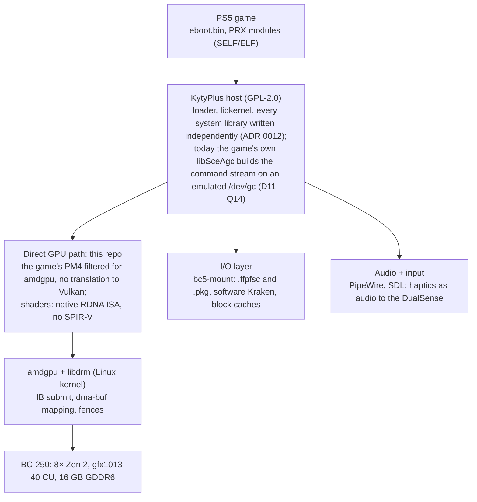

# BC5

**A PlayStation 5 emulator for the AMD BC-250, on Linux.**

The BC-250 is a small board AMD made for cryptocurrency mining. Its chip has the same building blocks as the PS5's: an 8-core Zen 2 CPU, a GPU that runs the same shader code as the console's (`gfx1013`, "Cyan Skillfish"), and 16 GB of fast GDDR6 memory that both share. BC5 uses that likeness to run PS5 games on it.

PC emulators have to translate a console's graphics for a different GPU. BC5 does not: the game's own graphics commands and shaders go straight to the BC-250's GPU. The rest of the console (system libraries, files, sound, controller) is rewritten inside the emulator. No PS5 firmware is needed. The flip side: BC5 runs on the BC-250 only. The games' shaders use instructions that no graphics card you can buy for a PC has in this combination.

<sub>Sources: [HANDOFF](docs/HANDOFF.md) F1, F13, F63, D13 and [ADR 0012](docs/decisions/0012-no-firmware-hle-host.md).</sub>

### What it can do today

- **ASTRO BOT is fully playable**, at about 60 fps in its first level, with the DualSense's motion, haptics and adaptive triggers, and with saves.
- **Marvel's Wolverine plays** (called "the second title" in the findings and below) from its menus through the opening into gameplay, with sound, saves and pause, with its ray-traced reflections switched on and, since 2026-10-23, with the DualSense's haptics. It ran at about 37 fps through an 18-minute session; the maintainer's verdict: "fully playable, minimal stutter".
- **Loading is quick again:** ASTRO BOT reaches its first logo about 12 s after a cold start (it was 33–50 s while the dev box's drive was nearly full).
- **Any other game is untested.** A game that needs a system library BC5 has not rewritten yet stops there.

### How you start it

On the maintainer's box a desktop shortcut, *BC5 emulator*, opens the emulator window. *File › Open* picks a game dump or a game package; a launcher script mounts it read-only and starts the game. Two more shortcuts start the same thing in other modes: *lean* has all measuring compiled out and is for playing, *MangoHud* adds an on-screen overlay for recordings.

### What is still broken

Patches of the water are missing on the second title's night lake. Now and then a GPU fault freezes the picture (the sound keeps playing) or takes the machine down; the most frequent trigger, a wait the host gave up on, is removed since 2026-10-24, the rarer stray GPU writes are not. Some cutscenes used to play the characters in slow motion; a re-check on the current defaults showed none. The ray-traced reflections still skip one pass, so they may be incomplete. See [Known issues](#known-issues).

### Legal, in short

BC5 is a hobby research project and is against piracy. You play games you own, dumped on your own PS5. This repository contains no Sony material (no firmware, keys, system software or game files) and links to none. Full text: [Legal](#legal).

## Status in numbers

As of 2026-10-24, measured on one BC-250 with the maintainer's own copies of the games. Every number is a finding (F1 … F312) in [`docs/HANDOFF.md`](docs/HANDOFF.md) §2, backed by an experiment under [`experiments/`](experiments/). A "flip" is one frame the game presented.

| | ASTRO BOT | Marvel's Wolverine (second title) |
| --- | --- | --- |
| State | Fully playable (F85) | Plays through menus, saves, New Game and Continue into gameplay (F207, F212); sound and game speed right, pause and resume (F240, F247); with reflections on, "fully playable, minimal stutter" in the maintainer's words (F277) |
| Frame rate | First level 59–60 fps at 3328×1872, 57 at native 4K (F100, F101); a later level 46.5 (F126); the water level 43.4 (F137) | 18-minute play with reflections on: 37.5 flips/s, against 39.4 with them off (F277); 300-s scripted route 37.9–38.6 (F280, F281); opening 44–52 (F247); the night jungle 28–29, GPU-bound (F244, F248). The game asks for 60 (F210) |
| Picture | 3D resolution chosen live in the F2 menu: 4K, ~1872p, ~1368p or 1080p (F101) | Paces itself by GPU time: keep the F2 resolution at 4K (scale 1.0); a higher scale halves its frame rate (F237) |
| Loading | Cold start to the first logo ~12 s (F287); startup reads are no longer bound by the disk (F289) | Logo load ends at 13–15 s, Continue into gameplay 37–41 s (F287) |
| Controller | Motion, haptics, adaptive triggers (F52–F60, F78–F80); with a DualShock 4, rumble from the haptics (F214) | Haptics (its ATRAC9 vibration tracks, F300, F301), touchpad press (F252); with a DualShock 4, rumble from the same tracks, also after an unplug and replug (F329) |

**On by default** (in both builds, normal and lean):

| What | Effect | Source |
| --- | --- | --- |
| Ray-traced reflections, second title (since 2026-10-22) | Six reflection-traversal variants run, their stack addresses fixed for Linux's memory apertures. The BVH compaction pass that feeds them is still skipped: it once halved the frame rate in play, though on the bench it is a load-time burst with no per-frame GPU cost and seven runs with it on stayed clean, so a play test with it on is next. Reflections reach the image; whether they are complete is not shown | F249, F250, F268, F275, F277, F304, F306 |
| Held tail (since 2026-10-24) | When a game-thread wait would time out, the host holds the rest of the submission instead of giving up on it (ADR 0013): given-up waits 14 → 0 a run, long frame gaps to about a quarter, +3 % frames | F284, F312 |
| Tiler scratch pool (since 2026-10-23) | The display buffer's per-flip detile reuses pooled scratch buffers instead of allocating a new one every frame, which stalled the host's GPU thread for 0.3–0.7 s under memory pressure | F308, F311 |
| Pad rumble off the game's threads, DualShock 4 (since 2026-10-24) | The rumble write runs on its own thread, so the game's audio thread never waits on the pad; with a DualShock 4 (no audio device) the pad-speaker sound plays on the TV without holding that thread, which had held it 1.1 s in two seconds; a replugged pad opened as a raw joystick still rumbles | F326, F328, F329 |
| DualSense haptics, second title (since 2026-10-23) | Its ATRAC9 streams in channel configurations 6 and 7 are the pad's haptic tracks, decoded with vgmstream's decoder instead of played as silence; confirmed at the pad | F300, F301 |
| APR read-ahead (since 2026-10-22, fixed 2026-10-23) | Streamed reads come back sooner: the cutscene read queue's 95th percentile from 3.4 s to 0.42 s; its reader threads sleep when idle (7–11 ms of CPU per 10 s instead of 160–208); large buffers and parallel runs stay with the queue's workers | F273, F281, F287, F288 |
| Submission chains, second title | Fewer kernel submissions (4,463 → 1,658 a second) and the night scene from 33 to 45 flips/s when measured | F218, F240 |
| Audio grain model and display-event coalescing | The second title's sound and timeline at real speed (1.00× for 10 minutes), no 30-fps cap needed | F246, F247 |
| Tessellation-factor ring, second title | The night scene's tessellated draws are drawn; the geometry engine's reads at address 0 are gone | F248 |

**The research so far:** 329 findings (F1–F329) in `docs/HANDOFF.md`, about 270 experiments (0001–0270) in `experiments/`, 14 architecture decision records in `docs/decisions/`.

### Known issues

| Issue | What is known | Findings |
| --- | --- | --- |
| Patchwork water on the second title's night lake | Cells of the water show the lake bed in some runs, switching on and off over seconds. The cells are holes in the frame's depth buffer: the water's full-screen pass is depth-tested behind ~130 GPU-driven depth writers and fails where one of them left a nearer depth. Ruled out: the textures and their detail clamps, the HTILE metadata, the render-size changes and any packet the host filters. Open: which writer leaves those cells | F255, F292, F296–F299, F303, F305, F307, F309, F310 |
| Freezes and machine-downs | Two kinds. (1) Two GPU rings time out with no fault after a game-thread wait the host gave up on; the host's synchronous wait held the very thread that would have submitted the awaited work (F284). The held tail removes these give-ups (on by default since 2026-10-24, F312). (2) A shader writes into heap the game never backed; the GPU faults, the rings reset and the picture freezes while the sound plays on (seen 2026-10-23). The host then learns that window and backs it next time (F257); where the shader's address comes from is open | F257, F260, F262, F279, F282–F284, F312 |
| Cutscene slow motion | Characters crawled while hair and effects ran on; their clock is a silent looping voice that stops when its next streamed read comes late. With the fixed read-ahead and the freed drive the cutscene that lagged on the scripted route plays at 1.00× (one run, 2026-10-23); whether it is gone everywhere is not shown | F254, F256, F259, F267, F273, F288, F302 |
| Library ports from AnyPS5 | Rumble without an audio sink, NpManager, NpTrophy2, SaveData search: ported, not yet verified on the box | F214–F217, Q16 |

## How it works



BC5 has three parts:

- **The host**, [KytyPlus](https://github.com/Coder787-source/KytyPlus) (GPL-2.0) with this repository's patch ([`backend/kytyplus-patches/`](backend/kytyplus-patches/)). It loads the game's own code and provides the loader, the kernel, audio, input and every system library the game calls, each written from public symbol names and the game's own calls (HLE). No firmware or system-software dump is used, ever (ADR 0012, D18). The one exception, to be replaced by a driver written in the host: the game's own copies of a few library modules from its dump's `fakelib/`, chiefly the graphics pair `libSceAgc` / `libSceAgcDriver` that builds the console-format command stream (D11, Q14).
- **The direct GPU path**, [`backend/`](backend/). The host hands the command stream over at the `/dev/gc` boundary (F12, F18, F19). The backend filters it for `amdgpu`, dropping or rewriting the packets the BC-250's command processor must not run (ADR 0005, F27). It supplies what the console's command processor does and `amdgpu`'s does not: the context-state stack, cross-queue label hand-overs, CP DMA waits (F34–F42). It maps the game's memory 1:1 into the GPU's address space as dma-bufs (ADR 0006, F40, F55). It submits with jobs in flight on the GFX ring and the game's asynchronous compute on the compute rings (ADR 0009, F178, F181), chained into fewer kernel submissions (ADR 0010, F218). Shaders are the game's native RDNA binaries; nothing is translated.
- **The tools**, [`tools/`](tools/) (Rust): `bc5-mount` reads PS5 game dumps (`.ffpfsc`) and packages (`.pkg`) as a read-only directory over FUSE; `bc5-agc` decodes GPU command streams.

What BC5 is not: a firmware boot (the PS5 boot chain cannot run on a BC-250, and BC5 loads no system software either way); a new emulator (it extends KytyPlus); a PC emulator (F63); a piracy tool.

## Build

Requirements:

- An AMD BC-250 with the community CPU and GPU unlocks (8 cores / 16 threads, 40 CUs; F14, D13) and the dynamic VRAM split in BIOS (D8).
- Linux with a Mesa/RADV that knows `gfx1013`; the dev box runs Bazzite with a KDE Wayland session (F13).
- `ttm.pages_limit` raised on the kernel command line so `amdgpu`'s GTT holds the game's memory (D12: 13 GiB on a 16 GB board), and the `udmabuf` device (ADR 0006).
- A DualSense on USB.

Everything builds inside an Ubuntu 26.04 distrobox named `ubuntu`, so the host system stays untouched. One idempotent script clones or fast-forwards this repository into `~/src/bc5`, clones KytyPlus at `f266548` into `~/src/KytyPlus` and applies the patch, then builds the backend and `kyty_emulator`:

```bash
bash ~/src/bc5/tools/scripts/bc5-build.sh
```

It builds a normal emulator (`~/bc5-work/kytyplus-build/src/kyty_emulator`, the previous one kept as `.prev`) and a lean one (`~/bc5-work/kytyplus-build-lean`, `-DKYTY_BC5_LEAN=ON`: every trace, journal and profiler compiled out; F236). Local changes in either checkout are saved to a diff file, never dropped. `BC5_BUILD_MOUNT=1` also builds `bc5-mount`; `BC5_BUILD_KEEP_KYTY=1` builds the KytyPlus tree as it is. The script's header lists every knob.

## Run

> **Direct mode sends raw command buffers to the GPU. A bad one can hang the display or reset the machine (F25, F27, F28). Save your work before every run.**

Games start from launcher scripts on the dev box, one per kind of image: `play-astro.sh` for a `.ffpfsc` dump, `play-pkg.sh` for a package. `play-any.sh` (the *BC5 emulator* shortcut) runs the empty window and hands the chosen image to the right one. A launcher mounts the image with `bc5-mount`, exports the shared settings of `bc5-run.env` plus the title's own switches (D15), and runs the emulator. `BC5_LEAN=1` makes them start the lean build. Committed snapshots: [`experiments/0177-lean-build/`](experiments/0177-lean-build/) (all three) and [`experiments/0188-audioout2-advanced-grains/`](experiments/0188-audioout2-advanced-grains/) (`play-pkg.sh`); the live copies on the box carry the values in the table below.

- **The window** (ADR 0011, D17): `kyty_emulator --menu` opens it with no game. The menu bar has *File* (open image or package, recent, close session, quit), *Emulation* (pause/resume, restart, settings, fullscreen, logging on/off) and *Help*. During play F1 or the pad's PS button shows and hides it. The host never mounts anything itself: it exits with code 76 (open), 77 (close) or 75 (restart) and the launcher acts on it.
- **F2** opens the settings menu: control bindings, ASTRO BOT's 3D resolution, saved to the input file (D14, F101). `KYTY_BC5_INPUT_CONFIG=<file>` names that file; [`input.example.cfg`](backend/kytyplus-patches/input.example.cfg) lists the names.
- **Recording:** `BC5_MANGOHUD=1` (the *MangoHud* shortcut) shows MangoHud's hardware figures and the emulator's own count of the game's frame rate (`KYTY_BC5_OSD_FPS=1`). MangoHud's own fps is meaningless here: the window presents at every vblank. An OBS profile for software encoding is in `tools/scripts/obs-bc5/`.
- **If it does not work:** out-of-memory submissions mean the GTT limit is not raised or another program holds GPU memory (F44); input dropping out for seconds is the controller's USB link (F61, F77); a picture that freezes for a few seconds and comes back is a timed-out submission and a reopened device (F74).

### Key switches

Environment variables; the launchers set the title's values. The full list, with the experiment behind each, is in [`backend/kytyplus-patches/README.md`](backend/kytyplus-patches/README.md).

| Variable | Default | What it does | Source |
| --- | --- | --- | --- |
| `BC5_GC_MODE` | `soft` | `direct` sends the game's command buffers to the GPU (hard rule 5); `soft` submits nothing | patch README, ADR 0005 |
| `BC5_DIRECT_STAGE` | `preamble` | Staged bring-up: `maponly` maps without submitting, `all` runs everything | patch README |
| `BC5_DIRECT_CHAIN` | off; `2` in `play-pkg.sh` | Submission chains across the game thread's ioctls | ADR 0010, F218 |
| `BC5_DIRECT_FLAT_APERTURE` | off; `1` in `play-pkg.sh` | Fixes the reflection traversal's stack addresses, which assume the console's memory apertures | F249, F250, F277 |
| `BC5_DIRECT_SKIP_PGM` | none; `909974400` in `play-pkg.sh` | Drops the dispatches of the listed shader programs (the BVH compaction) | F268, F277 |
| `BC5_DIRECT_AMM_PRT` | unset; `1` in `play-pkg.sh` | Maps the AMM pages the game never backs as partially resident, so its stray writes are dropped as on the console; set at all, even to `0`, it is on | F257, F260, F277 |
| `BC5_DIRECT_CS_PREFIX` | off; `1` in `play-pkg.sh` | Replays the compute state in front of graphics buffers that dispatch before setting their own program (a foreign program left by another queue) | F253, F254, F266, F316 |
| `BC5_DIRECT_DCB_WAIT_MS` | `8` | How long the game thread waits on a GPU label before giving up on it | F263, F270, F271 |
| `BC5_DIRECT_HOLD_TAIL` | on | Holds the rest of a submission instead of giving up on a game-thread wait (ADR 0013); `0` restores the give-up | F284, F312 |
| `KYTY_BC5_TILER_POOL` | on | Reuses the display detile's scratch buffers; `0` allocates one per flip as before | F308, F311 |
| `KYTY_BC5_APR_READAHEAD` | `4` | APR read-ahead reader threads per priority queue; `0` turns it off | F273 |
| `KYTY_BC5_AUDIO2_ADVANCED`, `KYTY_BC5_VIDEOOUT_COALESCE` | on | Audio grain model and display-event coalescing; `0` turns them off | F246, F247 |
| `KYTY_BC5_PAD_RUMBLE_FALLBACK` | on | With no controller audio device (a DualShock 4), turns the haptics stream into the pad's rumble; `0` turns that rumble off | F214, F329 |
| `KYTY_BC5_PAD_SPEAKER` | unset | Where the pad-speaker sound goes when the pad has no audio device: unset or `main`, the TV without holding the game's audio thread; `off` silent; `main-blocking` the old blocking port | F326, F328 |
| `KYTY_BC5_AT9_VIBRATION` | on | Decodes ATRAC9's vibration configurations 6–7 (the second title's haptic tracks) with vgmstream's decoder; `0` plays them as silence | F300, F301 |
| `KYTY_BC5_MIN_FLIP_RATE` | off | `1` caps the second title at 30 fps | F242, F247 |
| `BC5_LOGGING` | on | `0` starts the session with every trace and journal off | F227, exp 0162 |
| `SHADPS4_SYSMODULES_PACK_DIR` | none | Directory of the game's own library modules loaded LLE (being phased out) | F17, Q14 |

## Repository layout

```
README.md            this file
CLAUDE.md            standing instructions and the hard rules
docs/
  HANDOFF.md         research state: findings F1–F312 with sources, open questions, decisions
  PHASES.md          the gated roadmap (phases 0a–3 passed; 0b and 4 retired by ADR 0012)
  console-vs-host.md what the console does, what the host does instead
  decisions/         ADRs 0001–0014, one decision each
  formats/           derived format notes: ffpfsc, ps5pkg, agc, ajm-opus
  ports/             reviews of projects whose code can be ported (AnyPS5, others)
tools/
  bc5-mount/         Rust: .ffpfsc and .pkg as a read-only directory (FUSE)
  bc5-agc/           Rust: PM4/AGC command-stream decoder and report
  scripts/           bc5-build.sh, astro-route.sh, MangoHud and OBS setups
  third_party/       vendored oozextract (MIT)
backend/             C++20: the direct path (policy filter, state trackers, dma-buf mappings,
                     submission); kytyplus-patches/ the patch against KytyPlus
experiments/         one directory per experiment, 0001–0252
```

## How the research is run

- **One question, one experiment.** Each `experiments/NNNN-name/` has a README with Question, Setup, Result and Verdict, plus its scripts and raw logs. Once the verdict is written the directory is never edited; a later experiment corrects it instead.
- **[`docs/HANDOFF.md`](docs/HANDOFF.md) is the working memory.** §2 lists every finding (F-number, claim, source, confidence); a finding that turns out wrong is marked corrected and points to the one that replaces it. §3 holds the open questions (Q-numbers) with their plans, §4 the architecture, §6 related projects, §7 the decisions (D-numbers).
- **Decisions with lasting weight get an ADR** in [`docs/decisions/`](docs/decisions/); [0012](docs/decisions/0012-no-firmware-hle-host.md) is the no-firmware decision.
- **Further reading:** [`docs/PHASES.md`](docs/PHASES.md) (the roadmap and its gates), [`docs/console-vs-host.md`](docs/console-vs-host.md) (what the host still does differently from the console), [`docs/formats/`](docs/formats/) (container and stream formats), [`docs/ports/`](docs/ports/) (what can be ported from related projects).

## Hard rules

From [`CLAUDE.md`](CLAUDE.md); they bind every contributor and every tool run against this repository.

1. **No Sony material in the repo, ever**: no firmware, system modules, keys, SDK headers, `.self`/`.prx` from a console, game dumps, containers of real games, decrypted binaries, or links to any of these. Test data is synthetic or open-source homebrew.
2. **Never download, search for or link to game dumps, torrents, warez or "backports".** Reference public research code only.
3. **The leaked PS5 boot ROM keys are off-limits.**
4. **Hardware facts cite a source**: a public repo file, a public AMD document, or an experiment under `experiments/`. Anything unsourced is a `TODO(verify)`, not a fact.
5. **Raw GPU submission can hang the machine.** Everything that submits is behind an explicit switch, default off, and never runs in CI or tests.

## Contributing

Talk before coding: open an issue describing the experiment you want to run and what result would settle it. Register names, packet layouts and findings must cite a public source or an experiment in this repository.

## Legal

This is an interoperability research project and takes an explicit stance against piracy.

- **No Sony material is hosted or accepted here**: no firmware, system modules, keys, SDK files, game dumps or decrypted binaries, and no links to them. Pull requests or issues containing such material will be removed.
- **Bring your own hardware and games.** Running a game requires a PS5 you own and game copies you own, dumped on your own console. How you obtain and handle that material is your responsibility and subject to the laws of your country.
- **No firmware, no keys.** BC5 needs no PS5 firmware or system software and loads none (ADR 0012); it does not decrypt retail packages. The leaked PS5 boot ROM keys are neither needed nor welcome here.
- **No warranty.** Raw GPU submission can hang or reset the machine and, in principle, damage hardware. You use this software at your own risk.

PlayStation, PS5 and DualSense are trademarks of Sony Interactive Entertainment. ASTRO BOT and Marvel's Wolverine, and all other game titles and trademarks mentioned here, are the property of their respective owners. Game titles are named only to say which games BC5 has been tested with; this repository contains no logos, cover art, screenshots or other content from them. BC5 is not affiliated with, sponsored or endorsed by Sony Interactive Entertainment, Team ASOBI, Insomniac Games, Marvel or AMD.

## License and credits

GPL-2.0, matching KytyPlus, so that the patches and the backend can go upstream without relicensing. Files that originate elsewhere keep their own licence and say so in their header (the vendored `oozextract`, MIT; Mesa's register tables, MIT; the AnyPS5 ports, GPL-2.0; vgmstream's ATRAC9 decoder in patch 0001, ISC, with its `COPYING`).

BC5 stands on [KytyPlus](https://github.com/Coder787-source/KytyPlus) and the Kyty line it comes from, on [AnyPS5](https://github.com/boykopovar/AnyPS5)'s libraries, on Mesa's register tables and libdrm's tests, on `oozextract`, on [vgmstream](https://github.com/vgmstream/vgmstream)'s ATRAC9 decoder, and on the BC-250 community's documentation of the board's unlocks.
