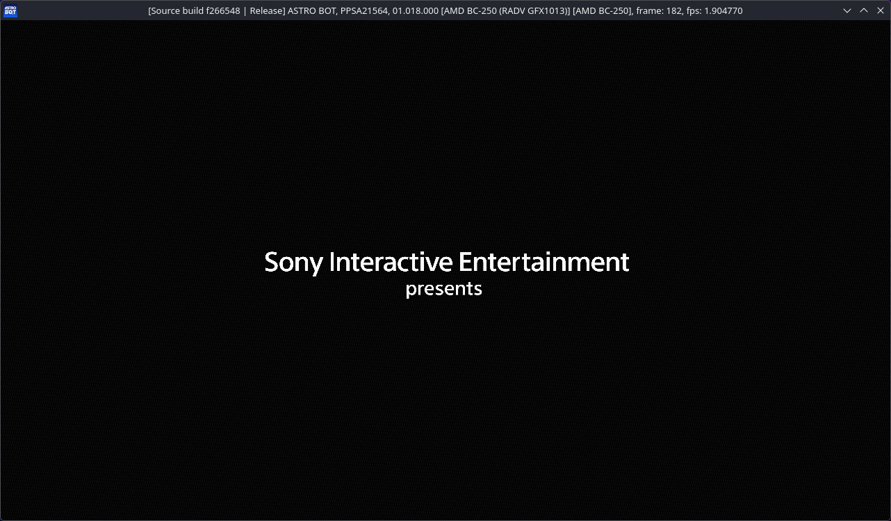
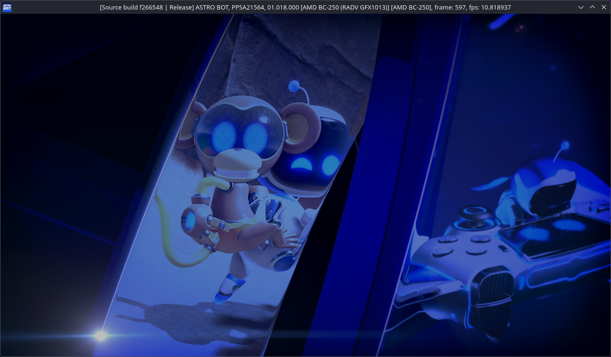
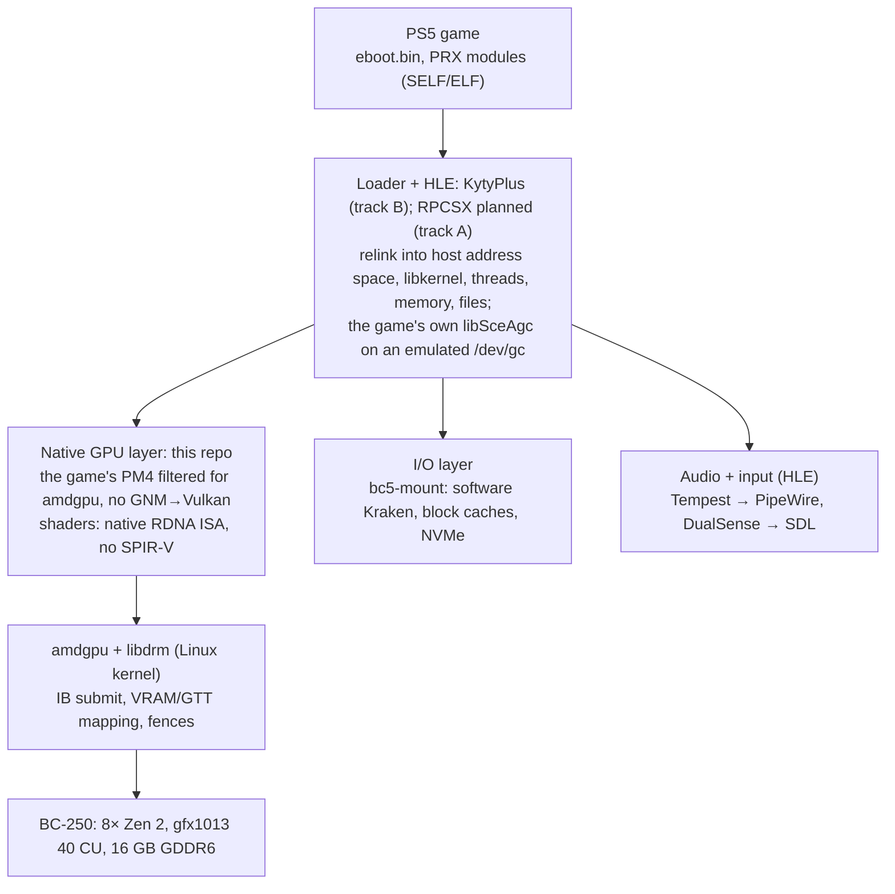

# BC5

**Run PlayStation 5 games on the AMD BC-250.**

BC5 runs PS5 games on the AMD BC-250 under Linux. The BC-250 is a mining board built around the same APU family as the PS5 (AMD Cyan Skillfish): a Zen 2 CPU, a `gfx1013` GPU and 16 GB of unified GDDR6. BC5 is built on the [KytyPlus](https://github.com/Coder787-source/KytyPlus) emulator (GPL-2.0), which loads the game's own code and stands in for the PS5's system libraries. What BC5 adds is a direct GPU path: the BC-250's GPU is the same shader target as the console's (F1), so the game's own command buffers and its native RDNA shaders go to the GPU through Linux's `amdgpu` driver, filtered but not translated to Vulkan. Two tools come with it: `bc5-mount` reads PS5 game dumps and packages as a read-only directory, and `bc5-agc` decodes GPU command streams.

> **Status: research / alpha.** One game, ASTRO BOT, is fully playable in the maintainer's judgement. A second title gets through its menus to the start screen of a new game. BC5 is built and tuned for the BC-250 alone. It contains no games, firmware, keys or Sony code, and never will: you need your own console and your own game dumps (see [Legal](#legal)).

[Status](#status) · [How it works](#how-it-works) · [Why the BC-250](#why-the-bc-250) · [Requirements](#requirements) · [How to start](#how-to-start) · [Open questions](#open-questions) · [Legal](#legal)

## Status

Every number below has its experiment under [`experiments/`](experiments/) and its finding (F1, F2, …) in [`docs/HANDOFF.md`](docs/HANDOFF.md). All of it was measured on one BC-250, with the maintainer's own copies of the games.

| Game | Read from | State | Frame rate |
| --- | --- | --- | --- |
| ASTRO BOT | `.ffpfsc` dump, through `bc5-mount` | **Playable.** Intro, menus, every level the maintainer has played; controller with haptics and adaptive triggers; saves (F85) | first level 59–60 fps (experiment 0046); a later level 46.5 (0067); the water level 40–51 |
| A second title (not named here) | PS5 debug package (`.pkg`), through `bc5-mount` | **Menus, saves, and the opening of a new game.** Intro and menus with sound and complete text (0115, 0122); settings and save slots kept between starts, dated, under the title's own ID (0145–0149); New Game loads, with the title's ray-traced reflections skipped (0123), through its opening to gameplay (0154, 0159: the AJM Opus decoder, the AMM pool, and one BVH compaction dispatch skipped with the reflection traversal; F199, F206, F207). Gameplay itself is untested; the ATRAC9 voices are silent (F200) | intro 29 fps (the title's own 30 fps limit); its start-up card 86 frames in its first six seconds instead of 21 (0156); menus 41–50; start screen 31 |
| Any other game | | Untested. A game that calls a system library KytyPlus has no stand-in for stops there | |

Latest (2026-10-17):

- The second title saves: an unresolved SaveData_native call had left its save thread waiting forever (0145, F189); its settings and slots survive a restart, dated in local time (0146, F190–F191).
- `bc5-mount` reads a package's `CNT` container and shows `param.json`, the icons and the PlayGo tables under `sce_sys/`; the host keys the title's saves and settings on its real title ID (0148–0149, F193–F194).
- The second title's opening plays: its clock was Wwise's play position of a 10-s Opus loop (0153, F198) that the host's AJM Opus decoder — a stub returning silence — never finished; the decoder now runs on libopus with the packet framing, the 512-sample jobs and the per-packet counters the title expects (0154, F199). Its ATRAC9 voices (channel configuration 7, unknown to LibAtrac9) play as silence (F200). The opening's hang (F201) had two causes in the host: the AMM automatic pool was never recycled (F206, fixed), and one BVH compaction dispatch of the night scene faults the GPU (F207, skipped like the reflection traversal); the opening now plays to gameplay (run 735).
- Deleting a save slot works: the host's system-dialog stand-ins now keep a progress dialog running until the title closes it, and the delete removes the save's directory tree (0158, F205).

Earlier (2026-10-15):

- Graphics pieces go to the GPU as one job with their state prefix; ASTRO BOT's tagged-address faults are gone (experiment 0119, F170).
- `bc5-mount` decodes each PFSC block once, with a 1 GiB block cache by default (0120, 0121, F171).
- The timestamp scale behind ASTRO BOT's dynamic resolution is now per title; the second title paces itself as written (0115, F168).
- The second title's menu text is clean (DMA source snapshots, 0122, F172) and New Game reaches its start screen (0123, F173).
- Six cleanup batches removed dead knobs and bring-up probes from the KytyPlus patch.



*2026-10-01, experiment 0016, run 79: the first recognisable frame. The maintainer's own copy of ASTRO BOT in the track-B host (KytyPlus with the game's own `libSceAgc`), its PM4 command buffers submitted to `amdgpu` on the BC-250's GFX ring and its RDNA shader binaries executed as they are. The window title names the GPU; these screenshots are the only game output in this repository.*



*The same day, experiment 0017, run 90: the game's first intro video, its frames uploaded by the command processor and composited by the game's passes, 11 frames per second.*

## What BC5 is not

- **Not a firmware boot.** The PS5 boot chain (PSP with Sony keys, Sony ABL/SMU, hypervisor) will not run on a BC-250, and the board lacks the console's southbridge, SSD/Kraken decompressor and Tempest audio. Everything here is user space on top of a normal Linux kernel.
- **Not a new emulator.** BC5 extends KytyPlus. The loader, the stand-ins for system libraries, audio and input come from it. BC5 contributes the GPU path, the patches that connect it to KytyPlus ([`backend/kytyplus-patches/`](backend/kytyplus-patches/)) and the tools.
- **Not a PC emulator.** The untranslated path needs the console's own GPU target. The games' shaders use instructions that no GPU you can buy has in this combination, except the console's silicon that the BC-250 carries (F63). For other hardware, see the translating projects under [Related projects](#related-projects).
- **Not a piracy tool.** See [Legal](#legal).

## How it works



KytyPlus, with the patch set in [`backend/kytyplus-patches/`](backend/kytyplus-patches/), loads the game and the game's own copies of Sony's graphics libraries, `libSceAgc` and `libSceAgcDriver`, from your dump. Those libraries build the console's command stream and hand it to an emulated `/dev/gc`. BC5's backend takes it from there:

- it filters the stream for `amdgpu`, dropping or rewriting the packets the BC-250's command processor must not run (ADR 0005);
- it supplies what the console's command processor does and `amdgpu`'s does not: the context-state stack, cross-queue label hand-overs, waits for CP DMA (F34–F42);
- it maps the game's memory 1:1 into the GPU's address space as dma-bufs of the host's own backing files (ADR 0006);
- it submits, with jobs in flight, on the one GFX ring.

I/O and audio stay in HLE. KytyPlus's Vulkan side only presents the finished frame. RPCSX would be a second host (track A), once its system software can be dumped.

### Backend modes

1. **Validation**: decode the AGC stream, log every PM4 packet and register write, submit nothing. Used to learn the format on real captures.
2. **Hybrid**: native shader binaries (ISA loaded into VRAM), commands still through Vulkan/RADV. Cautious path.
3. **Direct**: own libdrm_amdgpu client: BO allocation, 1:1 GPU VA mapping of the game's address space, IB submission with filtered packets. Full gain, highest risk (GPU hangs, no validation).

Mode 3 is what the results above run on; mode 1 produced the captures it was built from, and mode 2 was skipped.

### CU partitioning: 36 for the runtime, 4 for the desktop

The runtime can be masked to 36 CUs so frame timing matches the console, while the remaining 4 CUs stay free for the compositor and desktop. CU masks are SH registers written in our own IB: `COMPUTE_STATIC_THREAD_MGMT_SE0-3` for compute, `CU_EN` fields in `SPI_SHADER_PGM_RSRC3_PS/VS/GS/HS` for graphics stages (F7). Caveats: the desktop (via RADV) is not confined to the spare 4 CUs, it just usually finds them free; which 4 of 40 CUs are fused off differs per console, so games cannot depend on it; if a game writes its own CU masks, ours must be ANDed with them, not written over them.

Measured on the BC-250 (experiment 0019): the compute mask registers carry 20 live bits per shader engine, one per CU (bits 20–31 do nothing), so the board's 40 CUs are bits 0–19 of `COMPUTE_STATIC_THREAD_MGMT_SE0/SE1` and a 36-CU compute mask is 0x0003ffff; throughput is linear in the bit count. The graphics stages' `CU_EN` is a 16-bit field; which CUs it selects is still to be measured. The runs recorded so far use the full mask; the switch (`BC5_DIRECT_CU_MASK`) covers masks the stream sets directly and masks it loads from memory.

## Why the BC-250

| Component | PS5 | BC-250 (unlocked) | Relevance |
| --- | --- | --- | --- |
| CPU | 8× Zen 2, ~7 for games, up to 3.5 GHz, 128-bit FPU | 8C/16T after core unlock, up to ~4 GHz | Identical ISA; game code runs natively |
| GPU | 36 CU gfx1013, 2.23 GHz | 40 CU after CU unlock, ~2.2 GHz | Same ISA and hardware blocks; driver is `amdgpu` + Mesa, not Sony's. The runs here have the clock at 1850–2000 MHz |
| Memory | 16 GB GDDR6, 256-bit, unified | 16 GB GDDR6, 256-bit, unified | Identical; no bandwidth throttling needed |
| Storage | Custom SSD ~5.5 GB/s + hardware Kraken | NVMe in an M.2 slot that links at PCIe 2.0 ×2: 0.7–0.8 GB/s measured; no decompressor | A smaller gap than expected so far: the first level asks for a few MiB/s, and what made loading slow was the host (experiment 0022). A package's Kraken blocks are decoded in software by `bc5-mount` (F82, F88) |
| Boot / security | Sony PSP keys, Sony ABL/SMU, hypervisor | Generic AMD PSP (1022:143e), different ABL/SMU | Sony firmware cannot boot; we stay in user space |
| Audio / input | Tempest 3D, DualSense | Realtek/USB audio, a DualSense over USB | HLE in the host runtime; buttons, sticks, motion sensors, the orientation derived from them, adaptive triggers and haptics (an audio stream to the controller's own USB audio device) work in the game (F78–F80) |

**Optimised for this machine only.** All performance work targets the BC-250's own architecture: its `gfx1013` GPU and CU count, its 8-core Zen 2 CPU, unified GDDR6, its slow NVMe link, and the `amdgpu`/RADV stack on it. Portability to other hardware is not a goal and is never bought with speed here.

Key facts established so far (September–October 2026):

- **Both the PS5 GPU and the BC-250 are `gfx1013`** (GFX10.1 with ray-tracing instructions), not gfx10.3. A native-homebrew Vulkan project on a real PS5 compiles through the ACO GFX1013 backend, and Mesa/RADV identifies the BC-250 as the same target. There is no ISA gap to close; the only rule is to avoid `gfx10-3-insts` (F1).
- **AGC command buffers are standard PM4 type-3 packets.** Public emulator code frames them as generic PM4 and handles `SET_CONTEXT_REG`, `SET_SH_REG`, `RELEASE_MEM`, `WRITE_DATA`, `COPY_DATA`, `DMA_DATA`, `DUMP_CONST_RAM`, `DISPATCH_INDIRECT` and friends. Sony-specific register usage is expected in draw/CB/DB packets (F2, F3).
- **`amdgpu` does not parse GFX indirect buffers.** Submitting raw PM4 with shader binaries from user space is the normal path (this is what RADV does); privileged registers are protected by CP firmware. libdrm's `tests/amdgpu` contains dispatch and draw tests for gfx10 with embedded shader binaries: that was the starting point for phases 2 and 3 (F4, F5).
- **BC-250 caveats:** RADV disables the gfx1013 compute queue (use the GFX ring), and a GPU reset after a bad submission can take the whole machine down (F6, F31). Experiment 0016 catalogued the packets that do (HANDOFF, "reset classes").
- **The console's command processor does more than `amdgpu`'s.** A game's stream relies on `CLEAR_STATE` pushing and popping the context state, on CP DMA being finished before the next buffer, on labels and events handed over between queues. The backend supplies these by rewriting the stream around them. It is still the game's packets and shaders, not a translation (F34–F42).
- **Memory is the tight resource, not the GPU.** The game reserves 12.4 GiB of GPU-visible memory; a draw may touch any of it, so all of it that holds data must sit in `amdgpu`'s GTT domain at once, and that domain is half of the RAM unless `ttm.pages_limit` says otherwise (F44, D12). All guest memory reaches the GPU as dma-bufs of the host's own backing files, without copies and without the per-submission page walk of userptr (ADR 0006, experiment 0023).
- **The frame is mostly the GPU's own time.** The first level went from 6 to about 50 frames per second without a change to what the GPU executes: a minimal journal, merged dma-buf imports, a kept buffer list, no userptr (experiments 0022–0023), and submissions that overlap instead of being waited for one by one (experiment 0024). That last step needed the host to serve a queue the way the console does: in order, each entry as soon as its wait is satisfied, because the game's frame is a handshake of labels between its graphics and compute queues (F58).
- **The untranslated path is gfx1013's alone.** A census of 485 of the game's shader programs (experiment 0025) finds the multiply-add instructions RDNA2 removed in 449 of them and an instruction Navi 10/12/14 lack in 69. So no GPU you can buy runs this title's shaders as they are except the console's own silicon, which is what the BC-250 carries (F63).
- **A title installed from a PS5 package runs from the package.** `bc5-mount` reads debug packages (plaintext outer PFS, `naps_pkg_layout.dat`, Kraken blocks without Oodle headers) and needed two chunk forms no public decoder handled correctly (F82, F88). The second title then needed what ASTRO BOT never used: AMM, the console's address map manager, and APR, its file-streaming command buffers, both emulated by the host (F87–F89).
- **Past the GPU, progress is decided by the stand-ins for system libraries.** With no system software to load, every system library the game links against is a stand-in in the host: KytyPlus has most of them, and what it lacked was added here from public symbol names. The two stops after ASTRO BOT's first level were both there: a JSON getter that answered 0 for an unsigned count, and a save memory that lived only in RAM (F59); the ship that would not tilt was a pad orientation nobody computed (F60).
- **A host setting can change how a title paces itself.** ASTRO BOT's dynamic resolution follows its GPU timestamps, so scaling them picks its 3D size (F100). The same scale, applied to every title, made the second title wait out its whole frame limit; it is per title now (F165, F168).

## Games and formats

| Format | Read by | State |
| --- | --- | --- |
| Unpacked `app0` directory | the host directly | works |
| `.ffpfsc` container (PFS v2 → PFSC → exFAT), as dumped on the console | `bc5-mount` (FUSE, read-only) | works; ASTRO BOT plays from it ([`docs/formats/ffpfsc.md`](docs/formats/ffpfsc.md)) |
| PS5 package (`.pkg`, `FIH` magic), plaintext debug packages | `bc5-mount`, the same commands | works; every file of a 101.8 GB package (196.6 GB logical) reads without an error, the second title runs from it ([`docs/formats/ps5pkg.md`](docs/formats/ps5pkg.md), ADR 0007) |
| Encrypted (retail) PS5 packages | none | not read, and will not be: decrypting them needs console keys, which this project does not touch |

Whatever the format, the host loads two Sony modules from your own dump, `libSceAgc.sprx` and `libSceAgcDriver.sprx` (a container dump has them in `fakelib/`; a package has none, so they come from another of your dumps). It stands in for every other system library, so no system software is needed; a title that links against a library the host has no stand-in for stops there.

## Where it stands in detail

### ASTRO BOT

| What | Result | Record |
| --- | --- | --- |
| First image through the direct path (gate G3) | 2026-10-01, the game's opening card | experiment 0016, F37 |
| Intro, title screen | the whole intro video, 935 frames without a failed submission; the title screen in real time, a button press starts the game | experiments 0018, 0020, F43–F46 |
| Levels | the first level and its cutscene, through the galaxy map to the next level; the second level with its water and geysers; the maintainer has played further, the frog-glove level included, and calls the game fully playable. In the water the game's queues wait on each other in the middle of a buffer: graphics pieces behind a full-state prefix serve that and keep the fluid simulation on time (ADR 0008, F137); before, it ran a frame behind under an 8 ms stopgap (F64) | experiments 0021–0026, 0078, F47–F48, F52–F53, F59, F64, F78, F85, F137 |
| Video | the F2 menu's *Video* tab sets the 3D resolution the title renders at, live: 4K UHD (about 57 fps), 1800p class (3328×1872, 59–60), 1440p class (2432×1368) or Full HD 1080p (60, the GPU half free), the title's only four sizes; it scales them to its 4K output itself. The choice is kept per title (`RenderScale.<TITLE_ID>` in the input file, experiment 0115). Fullscreen at the display's resolution (also the F11 key); *Restart game* starts it again | experiments 0046–0048, 0115, F100–F102, F168 |
| Controller | buttons, sticks, triggers, shaking and tilting (orientation derived from the gyroscope and accelerometer), hot-plug; haptics through the DualSense's own USB audio device and adaptive triggers that answer the game ("works perfectly", the maintainer, 2026-10-08); any control can be rebound from a configuration file or the F2 settings menu in the game window; a script can drive the pad for unattended runs (`KYTY_BC5_INPUT_CMD`) | F52–F53, F60, F69, F73, F77–F80, experiment 0061 |
| Save | kept in a file and picked up at the next start | F59, F60 |
| Frame rate | title and loading 54–60 fps, cutscene 50–53, first level 59–60 at 3328×1872 (57 at native 4K), second level 40–51, a later level 46.5 (34.9 before the host work of 2026-10-13). From 6–8 fps without a change to what the GPU executes: host overhead removed, submissions overlapped, the flip queued behind the frame, the title's dynamic resolution fed scaled GPU timestamps, cheaper host passes and larger udmabuf imports | experiments 0022–0024, 0045–0046, 0061, 0064–0068, F49–F59, F99–F100, F119, F122–F126 |
| GPU time in a frame | first level 12.9 ms, second level 18.6 ms. In a later level after the work of 2026-10-13: the GPU busy 15.7 ms of a 21.5 ms frame; the host takes 4.9 ms of the game's draw thread (prepare 2.7, CS ioctls 1.0, hints 0.3); the frame is a latency chain of the game's own threads and the GPU, none of them saturated | experiments 0023–0027, 0061–0068, F65, F119–F126 |
| Loading | a level load in about 18 s, from 240 s: the host's directory scans, the mount's negative lookups and its single read thread were the cost, not the storage. The mount now decodes each PFSC block once, with a 1 GiB cache (95 % fewer repeated decodes); the end of the start-up load is the game's own pace | experiments 0022, 0029, 0032–0033, 0120–0121, F71, F83–F84, F171 |
| Cross-queue waits | a wait whose label a job already on the ring will set is left to the GPU: the game thread spends 4.1 ms a frame in the host instead of 12.2 (F117); in a later level the frame rate rises from 34.9 to 37.2 fps (F119). The waits that remain are served by graphics pieces. Sent as two jobs, a piece could pick up foreign state and fault (F169); sent as one job with its prefix, 6 runs of 6 are clean (F170) | experiments 0060–0061, 0072–0078, 0118–0119, F117, F119, F132–F137, F169–F170 |
| Longest runs | 30 minutes with jobs in flight, 1,332,438 submissions, none failed; hours of play by the maintainer | run 116, F85 |

### The second title

| What | Result | Record |
| --- | --- | --- |
| From its package | the whole package reads and mounts (288 files, every one decoded in 196 s); the title starts from the mount with the system modules of another of the maintainer's dumps | experiments 0031, 0034, 0036, F82, F86 |
| AMM and APR | the title maps memory through AMM, the console's address map manager, and streams files through APR command buffers; both emulated by the host | experiments 0035–0037, F87–F89 |
| Start-up | its start-up logo is a loading screen that waits for about 1.75 GB of file reads: 10.9 s, then 9.0 s with one decode per package block and parallel APR reads (`KYTY_BC5_APR_PARALLEL`), 7.9 s on later starts with decoded blocks kept on disk (`BC5_MOUNT_DISK_CACHE`) | experiments 0112–0113, F166–F167 |
| Compute work | its compute buffers' indirect dispatches (compute-queue form) run on the GFX ring, rebuilt with `SET_BASE` and `PFP_SYNC_ME`; the CP checks their arguments when it runs them and waits for earlier CP DMA copies, and with that the ray-tracing tree refit runs every frame | experiments 0038–0039, 0050, 0052–0053, F90–F91, F104, F106–F107 |
| Ray tracing | uses the base PS5's hardware ray tracing (a BVH traversal shader, `image_bvh_intersect_ray`), which the BC-250 runs natively, and no PS5 Pro features; renders its 3D view at 1664×936 | experiment 0049, F103 |
| Sound | its main output is a 12-channel AudioOut2 port (7.1.4) the emulator did not open; it is mixed down to 8 channels and the maintainer hears the game | experiment 0054, F108 |
| Scene, characters, menus | drawn with `DRAW_INDIRECT` and multi-draw packets the policy had dropped. Its shaders also call code through pointers that carry 0x80 in bits 47:40. With the indirect draws let through (`BC5_DIRECT_INDIRECT_DRAWS=multi`) and the code mapped again under that byte (`BC5_DIRECT_ALIASES=1`) the scene, the characters and the menus render | experiments 0054–0057, F108–F112, F118 |
| Frame pacing | the title paces its frames with a GPU spin on the GPU's clock counter. ASTRO BOT's timestamp scale, then applied to every title, made each frame wait out its whole limit (18 fps). With the scale per title the intro runs at 29.2 fps (the title's own 33.4 ms limit) and the menus at 48–50 fps | experiments 0105, 0109, 0115, F165, F168 |
| Menu text | the settings menus showed the options' preview pictures inside their text. The title uploads UI images and glyphs by CP DMA from rotating CPU staging, which already held the next upload when our job ran. Copying each graphics-buffer DMA source into a shared ring at submission (`BC5_DIRECT_DMA_SNAPSHOT=4096`) keeps the text clean at no measurable cost. The black Initial Setup screen is correct: the console shows it too | experiment 0122, F146, F164, F172 |
| New Game | hangs the GPU in the title's ray-traced-reflection traversal, which loops forever on a bad tree. With that one program skipped (`BC5_DIRECT_SKIP_PGM`) the title loads to its animated start screen at 31 fps, without ray-traced reflections, and runs 238 s without a fault or timeout. The game past that screen is untested | experiments 0058–0059, 0123, F113–F116, F173 |
| Saves | the title never saved: one SaveData_native call (`2mfSRGdshtk`) was unresolved and its "started" answer left the save thread polling for an event forever; answered "not found", the title writes its autosave, prefs and slot settings, finds them at the next start and lists them with their dates in local time (the save directory's time, the host's zone). Its saves live under its own title ID: the package keeps `param.json` in its `CNT` container, which `bc5-mount` now shows under `sce_sys/` with the icons and PlayGo tables | experiments 0145–0149, F189–F194 |
| Faults | the faults of its first runs were heap pages only the GPU had touched (imported in full since 0042) and the tree refit (fixed in 0053). Since then its runs end clean (six of six in 0053, ten minutes in the menu in 0108, every run of 0122), apart from the New Game hang above | experiments 0040–0042, 0053, 0108, 0122–0123, F92, F95–F96, F107 |

### Not there yet

- **Full speed in ASTRO BOT's later levels.** The frame has to go under 16.7 ms. In a later level it is 21.5 ms (2026-10-13): the GPU busy 15.7, the host 4.9 on the game's draw thread, the rest the game's own threads waiting on each other (F120). The host's submission cannot leave the game's thread, because the cross-queue order needs it there (F121).
- **The second title past its opening.** The opening plays (F199) but has only been run for 24 s at a time; its ATRAC9 voices are silent (channel configuration 7 is unknown to LibAtrac9, F200) and its ray-traced reflections stay skipped until the traversal's bad trees are understood (F116, F173). Whether the console also shows its intro at 30 fps is open (experiment 0115).
- **Tagged addresses.** The second title runs with its code mapped again under the 0x80 byte; whether the PS5 GPU ignores bits 47:40 of an address is unverified (F96, F109, F110).
- **RPCSX as the host.** It needs system software the maintainer cannot dump at present.

## Requirements

- AMD BC-250 with the community core and CU unlocks applied (8C/16T, 40 CU) and the dynamic VRAM split in BIOS. The core unlock survives a warm reboot but not a power cycle: after a cold boot check `nproc` and reboot once (HANDOFF D13). BC5 targets this board only; its GPU path does not run on other GPUs (F63).
- Linux with a recent kernel and Mesa/RADV that recognises gfx1013 (Bazzite or Fedora work; other distributions untested). Check whether your kernel carries the BC-250 PSP/CCP patch series.
- A container or distribution with a C++ toolchain, libdrm_amdgpu headers, CMake, Rust and the build dependencies of KytyPlus.
- For a full game on the direct path: the `udmabuf` device, and `ttm.pages_limit` raised on the kernel command line so that `amdgpu`'s GTT domain can hold the game's memory (HANDOFF D12: 13 GiB on the dev box). The M.2 slot and an ordinary NVMe drive are enough.
- A DualSense on a USB cable and port that hold the link: every drop of the link reads to the game as all buttons released (F61).
- Your own PS5 and your own game dumps, decrypted on your own hardware, as an unpacked `app0` folder, an `.ffpfsc` container or a plaintext (debug) PS5 package. See [Legal](#legal).

## How to start

This is how the dev box is set up, written so that it can be repeated on another BC-250. It has been done on one machine and with two titles (ASTRO BOT from a container, a second title from a PS5 package; the steps below follow ASTRO BOT), so expect to adjust paths and to meet things nobody has met yet. **Direct mode sends raw command buffers to the GPU: a bad one can hang the display or reset the machine. Save your work before every run.**

### 1. The board and the system

- BIOS with the dynamic VRAM split and a 512 MiB carve-out; core unlock and CU unlock applied (the BC-250 documentation linked under [Related projects](#related-projects) describes both).
- Bazzite or Fedora with a KDE Wayland session; the emulator window is opened on it.
- A larger GTT domain. Everything a draw can reach has to fit `amdgpu`'s GTT at once, and the default is half of the RAM (HANDOFF D12). On an image-based system:

  ```bash
  rpm-ostree kargs --append=ttm.pages_limit=3407872
  ```

  On other distributions add `ttm.pages_limit=3407872` to the kernel command line. That is 13 GiB in 4 KiB pages, for a board with 16 GB. Reboot and check:

  ```bash
  sudo dmesg | grep "GTT memory ready"
  ```

  It should say 13312M.
- The `udmabuf` device, readable and writable by your user (`ls -l /dev/udmabuf`). Its default limits work. A larger import limit makes a frame cheaper, because each CS lists fewer, larger buffers (experiment 0066: −0.5 ms a frame, and level loads without hitches):

  ```bash
  rpm-ostree kargs --append=udmabuf.size_limit_mb=1024
  ```

  The host reads the limit at start (`/sys/module/udmabuf/parameters/size_limit_mb`) and merges its imports up to 256 MiB.
- A GPU clock that is actually raised under load. The dev box runs the `cyan-skillfish-governor-smu` service with a range of 1850–2000 MHz, and every frame rate in this README was recorded that way (experiment 0024, runs 108–109). The dev box also boots with `mitigations=off`; what that is worth has not been measured.
- Memory: the game and the host need nearly all of the 16 GB. Close Steam, browsers and anything else that holds GPU memory.
- A DualSense on USB.

### 2. A build container

The builds are done in an Ubuntu 26.04 distrobox (the host system stays untouched):

```bash
distrobox create --name ubuntu --image ubuntu:26.04
```

```bash
distrobox enter ubuntu
```

Inside it:

```bash
sudo apt-get install --no-install-recommends --yes git cmake pkg-config cargo fuse3 libfuse3-dev libdrm-dev clang lld ninja-build glslang-tools libasound2-dev libdbus-1-dev libgl1-mesa-dev libpulse-dev libudev-dev libwayland-dev libx11-dev libxcursor-dev libxext-dev libxfixes-dev libxi-dev libxkbcommon-dev libxrandr-dev libxss-dev wayland-protocols libedit-dev libevdev-dev libjack-dev libopenal-dev libpng-dev libsdl2-dev libsndio-dev libssl-dev libvulkan-dev zlib1g-dev
```

### 3. Sources

BC5, and KytyPlus at the commit the patch is made against:

```bash
git clone https://github.com/RedMadKnight/BC5 ~/src/bc5
git clone https://github.com/Coder787-source/KytyPlus ~/src/KytyPlus
git -C ~/src/KytyPlus checkout f266548
git -C ~/src/KytyPlus submodule update --init --recursive --depth 1
git -C ~/src/KytyPlus apply ~/src/bc5/backend/kytyplus-patches/0001-bc5-lle-agc.patch
```

### 4. Build

The mount tool, the backend, then the host with the backend linked in:

```bash
cd ~/src/bc5/tools && CARGO_TARGET_DIR=~/bc5-work/bc5-tools cargo build --release --locked -p bc5-mount

cmake -S ~/src/bc5/backend -B ~/bc5-work/backend -G Ninja -DCMAKE_BUILD_TYPE=Release \
  -DCMAKE_C_COMPILER=clang -DCMAKE_CXX_COMPILER=clang++ -DBC5_WITH_AMDGPU=ON -DBC5_BUILD_TESTS=OFF
cmake --build ~/bc5-work/backend -j8

cmake -S ~/src/KytyPlus -B ~/bc5-work/kytyplus-build -G Ninja -DCMAKE_BUILD_TYPE=Release \
  -DCMAKE_C_COMPILER=clang -DCMAKE_CXX_COMPILER=clang++ -DKYTY_BUILD_LAUNCHER=OFF \
  -DKYTY_BC5_BACKEND_SRC=$HOME/src/bc5/backend -DKYTY_BC5_BACKEND_BUILD=$HOME/bc5-work/backend
cmake --build ~/bc5-work/kytyplus-build --target kyty_emulator -j8
```

The emulator is `~/bc5-work/kytyplus-build/src/kyty_emulator`.

#### Build from scratch

Steps 3 and 4 as one idempotent script, [`tools/scripts/bc5-build.sh`](tools/scripts/bc5-build.sh). It clones or fast-forwards this repository into `~/src/bc5`, clones KytyPlus at `f266548` into `~/src/KytyPlus` (or checks it out there) and applies the patch, then builds the backend into `~/bc5-work/backend-ubuntu` and `kyty_emulator` into `~/bc5-work/kytyplus-build` inside the `ubuntu` distrobox with the flags above. A re-run only redoes what changed. Run it on the box from any copy of the script, after steps 1 and 2:

```bash
bash ~/src/bc5/tools/scripts/bc5-build.sh
```

It refuses to start with less than 15 GB free, waits while an emulator is running before replacing the binary, keeps the previous one as `kyty_emulator.prev`, and prints the binary's timestamp and size and the commits used. Local changes in either checkout are saved to a diff file under `~/bc5-work` (and a `git stash` for `~/src/bc5`) before the trees are brought to origin `main` and `f266548` + patch, never dropped silently. Everything goes to `~/bc5-work/bc5-build.log`; a failure exits non-zero and names the log. `BC5_BUILD_KEEP_KYTY=1` builds the KytyPlus tree as it is (host experiments), `BC5_BUILD_MOUNT=1` also builds `bc5-mount`.

### 5. The game

You need your own copy, dumped and decrypted on your own console, in one of the formats under [Games and formats](#games-and-formats). A container is mounted read-only:

```bash
mkdir -p ~/bc5-data/mnt/game
~/bc5-work/bc5-tools/release/bc5-mount mount ~/bc5-data/games/GAME.ffpfsc ~/bc5-data/mnt/game &
```

The host runs the game's own `libSceAgc.sprx` and `libSceAgcDriver.sprx` and stands in for every other system library. It looks for the two modules in the directory `SHADPS4_SYSMODULES_PACK_DIR` names; in a container dump that is the game's `fakelib/` directory. No system software is needed. Keep dumps outside every git checkout.

**From a PS5 package.** It mounts the same way (`bc5-mount mount GAME.pkg <dir>`). The second title needed more than ASTRO BOT; another title from a package may need some of it:

- A package carries no `fakelib/`: the two modules come from another of your own dumps. For a title that streams with AMPR the pack must not contain that dump's `libSceAmpr.sprx` (the host's stand-in serves it either way, experiment 0035).
- The title's GPU heaps must be imported from the start: `BC5_DIRECT_EAGER_NAMES` takes the names the title gives its heaps (they appear in the journal's `direct by name` breakdown), plus `AMM` for its AMM pages; `BC5_DIRECT_LEARNED` gives it a fault file of its own (HANDOFF D15).
- Its compute queues' indirect dispatches run only with `BC5_DIRECT_MEC_INDIRECT=1` (off by default, HANDOFF D16), with their arguments checked by the CP (`BC5_DIRECT_GPU_CHECK=1`) and a wait for CP DMA before them (`BC5_DIRECT_DMA_SYNC=1`) (F91, F106, F107).
- Its scene, characters and menus need `BC5_DIRECT_INDIRECT_DRAWS=multi` and `BC5_DIRECT_ALIASES=1` with a file of the windows to map again (F108–F112); its menu text needs `BC5_DIRECT_DMA_SNAPSHOT=4096` (F172); its New Game needs its reflection traversal skipped with `BC5_DIRECT_SKIP_PGM` (F173). It runs without `BC5_DIRECT_FLIP_DEFER` (F141).
- Faster starts: `KYTY_BC5_APR_PARALLEL=8` (F166), `BC5_MOUNT_DISK_CACHE=<dir>` (F167), `BC5_DIRECT_REMEMBER_UNMAPPED=1` (F163).

The last committed launcher for the second title, [`experiments/0056-address-byte-aliases/play-pkg.sh`](experiments/0056-address-byte-aliases/play-pkg.sh), sets the first three groups; every switch is described in [`backend/kytyplus-patches/README.md`](backend/kytyplus-patches/README.md).

### 6. Run

Still inside the container, from the directory that is to hold the save (`_SaveData/` is created there):

```bash
cd ~/bc5-work
export GAME=~/bc5-data/mnt/game
export XDG_RUNTIME_DIR=/run/user/$(id -u) WAYLAND_DISPLAY=wayland-0 SDL_VIDEODRIVER=wayland
export SHADPS4_SYSMODULES_PACK_DIR=$GAME/fakelib KYTY_GUEST_MEMORY_MB=13824
export KYTY_BC5_ALL_RW=1 KYTY_BC5_DMABUF=1 KYTY_BC5_CACHE_MIB=96,16,16,16 KYTY_BC5_VMA_BLOCK_MIB=16
export BC5_GC_MODE=direct BC5_DIRECT_STAGE=maponly BC5_DIRECT_RINGS=1 BC5_DIRECT_REOPEN=1
export BC5_DIRECT_GDS_KIB=64 BC5_DIRECT_OA=16 BC5_DIRECT_GWS=64 BC5_DIRECT_GDS_ALL=1 BC5_DIRECT_GDS_SHADOW=1
export BC5_DIRECT_JOURNAL=min BC5_DIRECT_ASYNC=1
export BC5_DIRECT_LAZY_NAMES=orbis_user_malloc BC5_DIRECT_EAGER_NAMES=GpuGarlicMemory,GpuOnionMemory
export SDL_JOYSTICK_DISABLE_UDEV=1
~/bc5-work/kytyplus-build/src/kyty_emulator --game "$GAME" \
  --printf-direction Silent --shader-log-direction Silent --command-buffer-dump false
```

`BC5_DIRECT_STAGE=maponly` maps the game's memory and submits nothing: the window opens and stays without the game's picture. Use it once to see that the build, the mount and the mapping work, then set `BC5_DIRECT_STAGE=all` for the real thing. The frame rates in this README also need the play settings in the second half of the table. What the main settings do:

| Setting | What it does |
| --- | --- |
| `BC5_GC_MODE=direct` | the game's command buffers go to `amdgpu`; without it nothing reaches the GPU |
| `BC5_DIRECT_STAGE` | `maponly` submits nothing, `all` submits everything |
| `KYTY_GUEST_MEMORY_MB=13824` | guest memory; ASTRO BOT reserves 12.4 GiB of it for the GPU |
| `KYTY_BC5_DMABUF=1` | guest memory reaches the GPU as dma-bufs of the host's backing files (ADR 0006) |
| `BC5_DIRECT_ASYNC=1` | submissions overlap instead of being waited for one by one (experiment 0024); leave it out for the synchronous reference path |
| `BC5_DIRECT_JOURNAL=min` | a minimal journal; the full one costs half the frame |
| `KYTY_BC5_CACHE_MIB`, `KYTY_BC5_VMA_BLOCK_MIB` | keep the host's own Vulkan side small, the memory is needed for the game (experiment 0021) |
| `SDL_JOYSTICK_DISABLE_UDEV=1` | lets the controller be plugged in again while the game runs inside a container |
| *Play settings:* `BC5_DIRECT_FLIP_DEFER=1 BC5_DIRECT_MAX_IN_FLIGHT=24` | the flip is queued behind the frame and up to 24 jobs are in flight (experiment 0045) |
| *Play settings:* `BC5_DIRECT_RING_ASYNC=1` | the compute queues' jobs are not waited for either (experiment 0026) |
| *Play settings:* `BC5_DIRECT_RING_ORDER_WAITS=1` | a cross-queue wait that a job already on the ring will satisfy is left to the GPU (experiments 0055, 0060) |
| *Play settings:* `BC5_DIRECT_PIECES_FULL=1` | the waits that remain split a graphics buffer into pieces behind a full-state prefix (ADR 0008, experiment 0119) |
| `KYTY_BC5_TRIGGER_DEADZONE=<0..254>` | optional, for a controller whose trigger does not rest at 0 |
| `KYTY_BC5_INPUT_CONFIG=<file>` | optional: the input configuration (below) |
| `KYTY_BC5_LOGIN_USERS=<1..4>` | optional: logged-in local users, default 1 (a single-player game then opens one pad) |
| `KYTY_BC5_PAD_SPEAKER=main` | optional: keep the game's pad-speaker sounds on the main output instead of the controller's speaker |

**Controls.** The pad works as it is. To bind a control to a key, a mouse button or another pad input, to disable a pad button or axis (a trigger stuck at full travel, say), or to change the keyboard layout, write a configuration file and name it with `KYTY_BC5_INPUT_CONFIG=<file>` or `--input-config <file>`. One line per binding: `R2=O`, `Cross=Mouse:Left`, `Circle=Pad:a`, `Pad:righttrigger=none`, `DefaultKeys=off`; a `#` starts a comment, and every line is also accepted as a `--keymap` argument. The names and the built-in keyboard layout are in [`backend/kytyplus-patches/input.example.cfg`](backend/kytyplus-patches/input.example.cfg), which you can copy and edit.

**F2 in the game window opens a settings menu** over the game's picture that edits the same file: every control with a Bind button (press the key, mouse button or pad input you want), the pad inputs to ignore, the built-in layout, the 3D resolution, then Apply (live) or Save (the file, then live). The keyboard, mouse and pad drive the menu while it is open; F2 or Escape closes it. A wrong line stops the emulator with the file, the line and the reason. `KYTY_BC5_INPUT_TRACE=1` writes every key and every pad read to stderr when a binding seems dead; a key whose release arrives with its press (some keyboards do that for some keys) is held for `KYTY_BC5_KEY_MIN_HOLD_MS` (60) so the game sees it at all.

**The window has a menu bar** (ADR 0011, experiment 0164): *File* (Open game image..., Open package (.pkg)..., Recent, Close session, Quit), *Emulation* (Pause/Resume, Restart, Settings..., Fullscreen) and *Help* (About). `kyty_emulator --menu` opens the window with no game and a launcher page; during play F1 or the pad's PS button shows and hides the bar (the game gets no input while it is up). It is drawn into the game's frame, so it works fullscreen, with the mouse, the keyboard and the pad (d-pad or left stick, Cross, Circle, Square jumps to the bar). The host never mounts anything: *Open* writes the chosen path to `$KYTY_BC5_MENU_DIR/choice.txt` and exits with code 76, *Close session* exits with 77, *Restart* with 75, and a launcher script does the rest. On the dev box that is `~/bc5-work/play-any.sh` (the *BC5 emulator* desktop entry, [`experiments/0164-window-menu/play-any.sh`](experiments/0164-window-menu/play-any.sh)): it runs the empty window with the settings above, hands a `.pkg` to `play-pkg.sh` and a `.ffpfsc` to `play-astro.sh` — the mount, the system-module pack and the title's own switches stay in those scripts — and comes back to the empty window on 77.

All switches are listed in [`backend/kytyplus-patches/README.md`](backend/kytyplus-patches/README.md). To keep a record of a run, set `BC5_GC_DUMP_DIR=<directory>` and `BC5_DIRECT_TIMING=1`: the journal `direct.log` appears there, with every submission and its timing.

### 7. What to expect

With ASTRO BOT: the whole game as far as the maintainer has played it: intro videos, the title screen at 54–60 fps, a level load of about 18 s, the first level at 59–60 fps, a later level at about 46 (the water level at 40–51, measured before the host work of 2026-10-13), haptics and adaptive triggers on the controller.

With the second title (from its package, with the settings above): a start-up card of about 7 s (its loading screen; 0156), the intro at 29 fps, its menus at 41–50 fps with sound and complete text, and after New Game its animated start screen at 31 fps without ray-traced reflections. Pressing on from there is untested.

With any other title: unknown; a game that links against a system library the host has no stand-in for stops there.

If it does not work:

- *Submissions fail with out-of-memory errors in the journal, or the picture stops while a level loads*: the GTT limit is not raised, or another program holds GPU memory.
- *No controller*: plug it in before starting, or set `SDL_JOYSTICK_DISABLE_UDEV=1`; input that drops out for seconds is the USB link (`sudo dmesg | grep "USB disconnect"`).
- *The picture freezes for a few seconds and comes back*: a submission timed out and the host reopened the device; the journal says which one.
- *The machine resets*: that is the risk named at the top. Note the last lines of the journal and open an issue.

## Tools and code

`tools/bc5-mount` reads `.ffpfsc` containers (PFS v2 → PFSC → exFAT; layout in [`docs/formats/ffpfsc.md`](docs/formats/ffpfsc.md)) and exposes the game's `app0` tree. Rust, no unsafe code, every parser rejects malformed input instead of panicking.

- **Reads in parallel.** Reads are answered from a pool of worker threads with a shared block cache and decode-ahead for files read in order (`BC5_MOUNT_THREADS`, `BC5_MOUNT_PREFETCH_KIB`; experiment 0033: the level load 24 → 18 s).
- **Decodes each block once.** However many readers want a block, it is decoded once, and only readers of that block wait for it. `BC5_MOUNT_CACHE_MIB` sizes the cache: 1 GiB for `.ffpfsc`, 32 MiB for packages (experiments 0112, 0116, 0121).
- **Reads PS5 packages.** `.pkg` files with the `FIH` magic (outer PFS → `naps_pkg_layout.dat` → Kraken blocks → the inner PFS; layout in [`docs/formats/ps5pkg.md`](docs/formats/ps5pkg.md), ADR 0007), plaintext debug packages only, through the same commands; the file's magic picks the reader. Every file of the maintainer's 101.8 GB package (288 files, 196.6 GB logical) reads through the mount without an error, in 196 s (experiments 0031, 0036, F82, F88).
- **Decodes Kraken itself.** The Kraken blocks carry no Oodle headers: the reader synthesises them for the vendored `oozextract` (MIT), which it extends with the "excess" length framing every block uses, the single-symbol Huffman chunk an all-equal 128 KiB block is stored as, and chunks stored uncompressed inside a compressed block (`tools/third_party/oozextract/README-bc5.md`).
- **Keeps decoded package blocks on disk** for later starts (`BC5_MOUNT_DISK_CACHE=<dir>`, up to `BC5_MOUNT_DISK_CACHE_MIB`, default 8 GiB; experiment 0113).

```bash
cd tools && cargo build --release
bc5-mount inspect  GAME.ffpfsc                 # superblock, PFSC stats, file count, title from param.json
bc5-mount ls -r    GAME.ffpfsc [dir]           # list the tree
bc5-mount cat      GAME.ffpfsc sce_sys/param.json
bc5-mount verify   GAME.ffpfsc > hashes.txt    # sha256  size  path, one line per file
bc5-mount mount    GAME.ffpfsc /mnt/app0       # read-only FUSE mount (Linux, feature `fuse`, default on)
bc5-mount inspect  GAME.pkg                    # the same commands take a PS5 package (debug, plaintext)
```

Tests never touch a real dump: `bc5-fixture` builds deterministic synthetic containers (`bc5-fixture list|build|tree|hashes`), and the test suite round-trips every preset through the full stack. `cargo test` runs everywhere; `cargo test -- --ignored` adds a 1 GiB sparse case.

`tools/bc5-agc` (phase 1) decodes PM4 command-stream captures: `bc5-agc dump <capture>` prints every packet and register write by name (GFX10 names from Mesa's register tables, vendored under `tools/bc5-agc/regdb/` with their MIT licence), `bc5-agc report <captures…>` counts opcodes, unresolved register offsets and CU-mask writes. How RPCSX hands AGC to its PM4 interpreter is documented in [`docs/formats/agc.md`](docs/formats/agc.md).

`backend/` (C++20) is the direct path: `bc5::direct::Device` owns the scratch IB, the packet policy filter, the context-state stack, the full-state tracker behind graphics pieces, the CU-mask tables, the dma-buf mappings, the DMA source snapshot ring and the submission; `backend/experiments/` holds the small programs each step was proven with (`dispatch-min`, `draw-min`, `dmabuf-min`). Its tests run without a GPU; anything that submits is behind an explicit switch and never runs in CI.

## Roadmap

Gated phases; each ends with an experiment whose result decides whether the next one makes sense. No dates.

| Phase | Work | Gate |
| --- | --- | --- |
| 0a Input | `bc5-mount`: a FUSE mount for `.ffpfsc` containers (PFS v2 → PFSC decompression → exFAT), exposing a game dump as a plain `app0` directory so every later phase works on one canonical input; read-only, no re-packing | A container mounts and its file tree and checksums match the unpacked dump |
| 0b Foundation | Build RPCSX on the BC-250 (distrobox/Fedora), boot PS5 VSH and safe mode through the stock Vulkan backend, record baseline FPS and RADV logs | VSH boots |
| 1b Track B | KytyPlus (GPL-2.0) as an HLE host that LLE-loads the game's own `fakelib/libSceAgc.sprx` and `libSceAgcDriver.sprx`; implement the kernel imports Sony's driver needs and capture its `/dev/gc` submissions: Sony's command stream without a firmware dump | A DCB built by Sony's code is captured and decodes |
| 1 Validation | AGC stream parser (references: Kyty `guest_gpu`, RPCSX, astraea), tapped into the host, logging every packet and register | A full frame decodes with zero unknown opcodes |
| 2 Native shaders | Load a compute shader binary from a capture into VRAM and run it through `amdgpu` (pattern: libdrm `shader_code_gfx10.h`, IGT `amdgpu_dispatch_shader`); compare with the same shader through Kyty's recompiler | Bit-identical results |
| 3 IB submit | Own libdrm_amdgpu client: the game's memory mapped 1:1 (dma-bufs of the host's backing files, ADR 0006; userptr at first), its command buffers filtered (not rewritten) and submitted to the GFX ring; 36/40 CU switch and measurement. **Gate passed 2026-10-01**, with the deviations recorded in `docs/PHASES.md`. Beyond submitting it took an emulation of the console CP's context-state stack, the queues' label hand-overs and event wake-ups, a wait for CP DMA after every buffer and the doorbell-queue protocol (HANDOFF F34–F42); then memory (a draw names all of the game's GPU-visible memory, which has to fit `amdgpu`'s GTT domain: F44–F47, D12) and frame time, from 6–8 fps to 59–60 in the first level (experiments 0022–0024, 0045–0046). Open inside this phase: the graphics stages' CU mask, presentation without a copy. | Image on screen, no GPU hang |
| 4 Integration | Backend as a build option in RPCSX (or a `rpcsx-bc250` fork); first 2D title from Kyty's compatibility list | Game menu through the native path |

Phase 0a came first on purpose: one canonical input format keeps every later experiment reproducible and lets dumps made on the console (which come out as FFPFSC) be used as they are. Phase 3 is the first point where this project contributes something no other project has; phases 0–2 are preparation and measurement.

Where the gates are (`docs/PHASES.md`): 1b, 2 and 3 are passed, all on track B. 0b and 4 name RPCSX, which needs the console's system software; the maintainer cannot dump it at present, so the work continues on KytyPlus, where one game plays through and a second reaches the start screen of a new game.

## Open questions

The full list, with plans, is in [`docs/HANDOFF.md`](docs/HANDOFF.md), section 3.

Open:

- [ ] **60 fps in ASTRO BOT's later levels.** The first level is there: with the flip deferred and 24 jobs in flight the GPU never idles (F99), and with its GPU timestamps scaled the title's dynamic resolution settles at 3328×1872 and 59–60 fps (F100). A later level runs at 46.5 fps (F126): the host's share of the game's draw thread went from about 13 to 4.9 ms (F119, F122–F126), and the frame is now a latency chain of the game's own threads and the GPU (F120). Moving the submission off the game's thread broke the cross-queue order (F121). Open: why the title's timestamps read low unscaled (F100, `TODO(verify)`), and what is left in the game's own threads.
- [ ] **The second title's reflection traversal** (F113–F116, F173). With the multi-draw packets on, its ray-traced-reflection BVH traversal loops forever on some trees; the trees it was caught on look correct, and the suspect is a multi-drawn character's instance record (F116, experiment 0123). It is skipped until this is understood.
- [ ] **Console-specific packets and registers** (HANDOFF Q4). Parked while only ASTRO BOT ran; reopened by the second title: the compute-queue form of `DISPATCH_INDIRECT` (F90) and a zero-length `LOAD_SH_REG_INDEX` (F95). More important than any register so far was command-processor behaviour the console's system provides and `amdgpu` does not: `CLEAR_STATE` push/pop (F35), waiting for CP DMA (F41), register shadowing.
- [ ] **Virtual-address bits 47:40.** The second title's function pointers and heap pointers carry junk in bits 47:40 with a valid low 40 bits (F96, F109, F110): does the PS5 GPU ignore them, as the PS4's 40-bit GPU addresses would? Mapping the code again under the byte (`BC5_DIRECT_ALIASES`) is how the title runs today (F112).
- [ ] **Presentation without a copy.** KytyPlus copies and detiles the flipped buffer (tiled 3840×2160, 33 MB) before showing it, and hands it back to the game right after the copy (F129, F131). A custom path could save about 1–1.2 ms of the 2.9 ms this takes; leaving the display buffer's flip-label wait to the GPU took the machine down twice (F130).

Answered:

- [x] **Cross-queue waits as the console serves them.** The host served every wait of a buffer on the CPU before the buffer went, which cannot express two queues waiting for each other in the middle of a buffer (ASTRO BOT's water, F64). Most waits are now left to the GPU when a job already on the ring will set the label (F109, F117). The rest split a graphics buffer into pieces, each behind a full-state prefix rebuilt by the backend's tracker (ADR 0008, F132–F137), sent as one job with its prefix (F170). Still to come: a long play session through the water with pieces as one job (experiment 0119). CP register shadowing as Mesa sets it up (`ac_create_shadowing_ib_preamble`) remains untried on gfx1013.
- [x] **The second title's stops** (F90–F96, F104–F107). Its compute-form indirect dispatches run on the GFX ring (F91); its GPU-only heaps are imported in full (F96); its tree refit runs every frame once the CP checks indirect arguments and waits for its DMA copy (F106, F107). Runs since then end clean, apart from the New Game hang (F173).
- [x] **The second title's frame pacing.** It paces frames with a GPU spin on the GPU's clock counter; the "170 MHz" it seemed to expect was ASTRO BOT's timestamp scale applied to every title. The scale is per title now (F165, F168).
- [x] **The second title's menus.** Its menus take the controller's input and its sound plays (F108). The missing letters were the frame pacing (F165), the pictures inside the text were stale CP DMA staging (F172), and the black Initial Setup screen is what the console shows too (F164, F172).
- [x] **The second title's load.** About 70 s to its first 3D scene (experiment 0051, F105): most of the earlier 95–155 s were the host walking its own imported memory for a journal report. Its start-up logo then went from 10.9 to 7.9 s with one decode per package block, parallel APR reads and decoded blocks kept on disk (F166, F167). The storage was not the limit, as with ASTRO BOT (F84).
- [x] **1:1 memory mapping.** Yes (experiment 0014, F23): a userptr BO mapped at GPU VA = CPU pointer works with zero copies. Since experiments 0017 and 0023 all guest memory is imported as dma-bufs of the host's memfds and mapped at the guest's addresses, without userptr's per-submission page walk (ADR 0006, F40, F55).
- [x] **How RPCSX handles AGC.** It has no AGC parser; PS5 submits enter through `/dev/gc` ioctls carrying a `CONTEXT_CONTROL` packet, a state-preamble IB and the frame DCB (F12, F19). Track B therefore runs the game's own `libSceAgc` on an emulated `/dev/gc`.
- [x] **Whether PS5 titles write CU masks themselves.** Yes (F21, F39): every compute dispatch writes `COMPUTE_STATIC_THREAD_MGMT_SE0..3` = 0xffffffff and the graphics stages load `RSRC3.CU_EN` = 0xffff; BC5's mask is ANDed into both. On the BC-250 bits 0–19 per shader engine are one CU each (experiment 0019). *Parked:* which CUs the graphics stages' 16-bit `CU_EN` selects; not needed to play.
- [x] **Overlapped submission.** The host prepares and submits the next buffer while the GPU runs the previous one without breaking the label and event protocol the game's driver library expects (experiment 0024, F57–F59): 30 minutes and 1.3 million submissions without a failure. Page faults with jobs in flight do occur (F74, F90) and the host recovers from them in ASTRO BOT.
- [x] **Storage for ASTRO BOT.** The board's M.2 delivers 0.7–0.8 GB/s and is never the limit; the load went from 240 s to about 18 s by fixing the host (F51, F71, F83–F84).
- [x] **Haptics.** The game drives the DualSense's actuators with an audio stream, which the host sends to the controller's USB audio device as six channels with the actuators on 5–6 (F69, F79, F80); the controller's PipeWire sink and its ALSA `PCM` control must both be at 100 %, which [`pad-volume.sh`](backend/kytyplus-patches/pad-volume.sh) sets from the host even when the launcher runs in the container, and keeps after a replug (F94). Confirmed in the game on 2026-10-08.
- [x] **The memory budget of a 16 GB board.** ASTRO BOT's 12.4 GiB of GPU memory, the host and a desktop fit with the dev box's play settings; no level has failed to load (F85). With `bc5-mount`'s 1 GiB block cache 3.7 GB stay free at the low point (experiment 0121).
- [x] **Reading PS5 packages.** Plaintext debug packages read and mount, Kraken blocks included, through a vendored, extended `oozextract` (F82, F88).

## Related projects

| Project | What it is | Why it matters here |
| --- | --- | --- |
| [KytyPlus](https://github.com/Coder787-source/KytyPlus) | Fork in the Kyty line (GPL-2.0), HLE system libraries | Track-B host runtime and BC5's base: loads the game's own `libSceAgc`; everything measured so far runs on it |
| [KytyPS5](https://github.com/KytyPS5/KytyPS5) | PS5 emulator (GPL-2.0), fastest-moving; `guest_gpu` + RDNA→SPIR-V recompiler; the upstream of KytyPlus's HLE libraries | Reference for AGC decoding and shader results; its AMPR, ATRAC9, filesystem and system-service fixes were ported into the track-B patch (F76, F89) |
| [RPCSX](https://github.com/RPCSX/rpcsx) | PS4/PS5 emulator for Linux, loads real system software (RPCS3 model) | Track-A host runtime; needs the console's system software |
| [SharpEmu](https://github.com/sharpemu/sharpemu) | PS5 emulator in C#, accuracy-first | Reference for the loader and file layout |
| [AnyPS5](https://github.com/boykopovar/AnyPS5) | Relinker + library reimplementation (Wine model), GPL-2.0 | AGC recorder driver with a documented packet set; an APR/AMM engine with the full AMM command set (F88) |
| [prosper](https://github.com/mattias800/prosper) | User-space PS5→PC layer, AGC→Vulkan | Second description of the AGC format |
| [ps5-vulkan](https://github.com/mpereiraesaa/ps5-vulkan) | Vulkan-style API for native PS5 homebrew, gfx1013 | Closest existing code to native submission on this silicon |
| [OpenProspero/AGC](https://github.com/OpenProspero/AGC) | Clean-room PS5 GPU driver, PM4 snapshots simulated on CPU | Documents which packets are public and which are not |
| [astraea](https://github.com/astraea-emu/astraea) | PS5 frontend framing AGC DCB as PM4, lowering `SET_SH_REG` to IR | Packet-framing reference |
| [PS5 PKG Tool](https://github.com/pearlxcore/PS5PKGTool) | Managed exFAT, PFSC and PFS implementations; converts between dump folders, exFAT, FFPKG and FFPFSC | Reference for `bc5-mount` (phase 0a) |
| [LibProsperoPKG](https://github.com/SvenGDK/LibProsperoPKG), [pkg-to-anyps5](https://github.com/awake-devel/pkg-to-anyps5) | PS5 package readers (GPL-3.0) | Documentation of the package layout and the Kraken "excess" framing behind `bc5-mount`'s package reader; no code taken (F82) |
| [oozextract](https://github.com/lvlvllvlvllvlvl/oozextract) | Rust port of the open-source Oodle decompressors (MIT) | Vendored in `tools/third_party` for the packages' Kraken blocks, with three local fixes |
| libdrm `tests/amdgpu` | Dispatch/draw tests for gfx10 with embedded shader binaries | Starting code for phases 2–3 |
| [AMD-GPU-Debugger](https://github.com/orgito1015/AMD-GPU-Debugger) | Raw PM4 submission via libdrm, ACO null-winsys compilation | Worked example of the direct path |

BC-250 documentation: [elektricm/amd-bc250-docs](https://elektricm.github.io/amd-bc250-docs/), [bc-250.com wiki](https://bc-250.com/wiki), [Phoronix: RADV for Cyan Skillfish](https://www.phoronix.com/news/AMD-RADV-PS5-BC-250), [akandr/bc250-rocm](https://github.com/akandr/bc250-rocm).

## Contributing

Talk before coding: open an issue describing the experiment you want to run and what result would settle it. Each experiment has its own directory with notes, scripts and raw results (logs, captures, FPS), so the next person starts from facts rather than memory. Register names, packet layouts and findings must cite a public source or an experiment in this repo.

## Legal

This is an interoperability research project and takes an explicit stance against piracy.

- **No Sony material is hosted or accepted here**: no firmware, system modules, keys, SDK files, game dumps or decrypted binaries, and no links to them. Pull requests or issues containing such material will be removed.
- **Bring your own hardware and games.** Running a game requires a PS5 you own and game copies you own, dumped on your own console. How you obtain and handle that material is your responsibility and subject to the laws of your country.
- **No firmware, no keys.** BC5 needs no PS5 firmware or system software, and it does not decrypt retail packages. The leaked PS5 boot ROM keys are neither needed nor welcome in this project.
- **No warranty.** Raw GPU submission can hang or reset the machine and, in principle, damage hardware. You use this software at your own risk.

PlayStation and PS5 are trademarks of Sony Interactive Entertainment. BC5 is not affiliated with or endorsed by Sony or AMD.

## License and credits

GPL-2.0, matching KytyPlus and RPCSX, so that the patches and the backend can go upstream without relicensing. Files that originate elsewhere keep their own licence and say so in their header.

BC5 stands on [KytyPlus](https://github.com/Coder787-source/KytyPlus) and the Kyty line it comes from, on Mesa's register tables and libdrm's tests, on `oozextract`, and on the BC-250 community's documentation of the board's unlocks.
