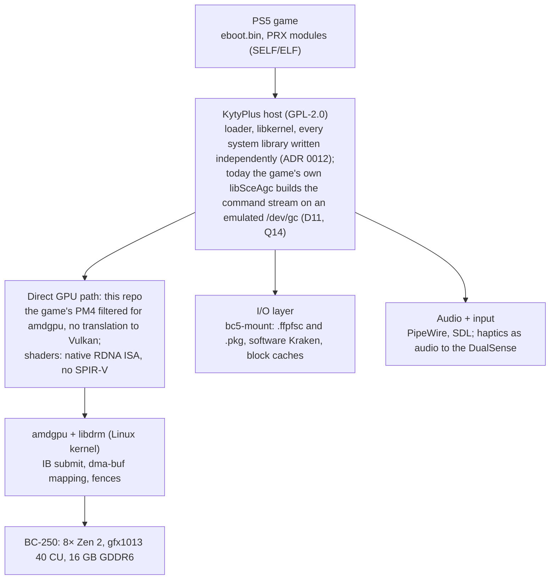

# BC5

**A PlayStation 5 emulator for the AMD BC-250, on Linux.**

The BC-250 is a small board AMD made for cryptocurrency mining. Its chip has the same building blocks as the PS5's: an 8-core Zen 2 CPU, a GPU that runs the same shader code as the console's (`gfx1013`, "Cyan Skillfish"), and 16 GB of fast GDDR6 memory that both share. BC5 uses that likeness to run PS5 games on it.

PC emulators have to translate a console's graphics for a different GPU. BC5 does not: the game's own graphics commands and shaders go straight to the BC-250's GPU. The rest of the console (system libraries, files, sound, controller) is rewritten inside the emulator. No PS5 firmware is needed. The flip side: BC5 runs on the BC-250 only. The games' shaders use instructions that no graphics card you can buy for a PC has in this combination.

<sub>Sources: [HANDOFF](docs/HANDOFF.md) F1, F13, F63, D13 and [ADR 0012](docs/decisions/0012-no-firmware-hle-host.md).</sub>

## How to start

From a BC-250 with nothing on it to the lean emulator, the build meant for playing, in one script.

**You need:**

- **The board:** an AMD BC-250 with the community CPU and GPU unlocks (16 threads, 40 CUs) and the BIOS's dynamic VRAM split at 512 MiB. The [Build](#build) section has the details.
- **The system:** [Bazzite](https://bazzite.gg/) with its KDE desktop, which is what BC5 is developed on. Another Linux works if it has `distrobox`, `podman` and a Mesa that knows `gfx1013`.
- **Space and network:** about 15 GB free and a network connection for the first install. The lean install itself takes about 3 GB; your games come on top.
- **A controller:** a DualSense on USB, or a DualShock 4.
- **Your own games,** dumped on your own PS5: a `.ffpfsc` image or a `.pkg`. The second title also needs three modules (`libSceAgc`, `libSceAgcDriver`, `libScePsml`) from another game's dump; ASTRO BOT's has them.

**Install:**

1. Get the repository:
   ```bash
   git clone https://github.com/RedMadKnight/BC5.git ~/src/bc5
   ```
2. Check the machine. This changes nothing:
   ```bash
   bash ~/src/bc5/tools/scripts/bc5-install.sh check
   ```
   BC5 needs two kernel arguments: `ttm.pages_limit=3407872`, so the GPU can hold 13 GiB of game memory, and `udmabuf.size_limit_mb=1024`. If the check reports them missing, add them, reboot, and run the check again:
   ```bash
   bash ~/src/bc5/tools/scripts/bc5-install.sh kargs
   ```
   On Bazzite this runs `rpm-ostree kargs` and asks for your password. On other systems it prints what to add.
3. Install:
   ```bash
   bash ~/src/bc5/tools/scripts/bc5-install.sh
   ```
   The script:
   - creates an Ubuntu 26.04 container named `ubuntu` with `distrobox`, so the system itself stays untouched;
   - builds the lean emulator and `bc5-mount` in it, from KytyPlus at its pinned commit plus this repository's patch;
   - puts the launchers in `~/bc5-work`;
   - adds a **BC5 emulator (lean)** shortcut to the desktop and the application menu.

   On the BC-250 the first run took about 10 minutes on 2026-11-15, most of it the build; a slower connection adds to that. A later run updates the repository and rebuilds only what changed. A launcher you have edited is kept next to the new one as `*.bak-<time>`.
4. **Play.** Start *BC5 emulator (lean)*. Then either:
   - *File › Open game…* plays a `.ffpfsc` image or a `.pkg`, mounted read-only;
   - *File › Install game…* unpacks one into `~/bc5-data/games/` once, which makes later loads faster. Installed games are listed under *File › Installed games*. The install from this menu is new and has been tried less than *Open game*.

   For the second title, install ASTRO BOT first, or run `bash ~/src/bc5/tools/scripts/bc5-install.sh pack <ASTRO BOT image>`, to provide the three modules.

While a game runs, the lean shortcut stops the Plasma panel and desktop to free memory, and starts them again when the game ends. *F1* or the pad's PS button opens the menu, and *F2* opens the settings (controls, resolution). Before you play, read [Run](#run): a bad command buffer can hang the GPU or restart the machine. `BC5_INSTALL_NORMAL=1` also builds the normal emulator, with its measurements and logs, and adds its shortcut. The header of [`bc5-install.sh`](tools/scripts/bc5-install.sh) lists every option.

### What it can do today

- **ASTRO BOT is fully playable**, at about 60 fps in its first level, with the DualSense's motion, haptics and adaptive triggers, and with saves.
- **Marvel's Wolverine plays** (called "the second title" in the findings and below) from its menus through the opening into gameplay, with sound, saves and pause, with its ray-traced reflections switched on and, since 2026-10-23, with the DualSense's haptics (rumble with a DualShock 4). In October it ran at about 37 fps through an 18-minute session, with the maintainer's verdict "fully playable, minimal stutter" (F277); at his later save the scripted route runs at 25–26 fps with ray tracing on (2026-11-13, F832, F834). Ray tracing can be switched off live in the emulator's menu (since 2026-10-24; about 48 fps in a 10-minute session in October, without reflections, F338).
- **Loading is quick again:** ASTRO BOT reaches its first logo about 12 s after a cold start (it was 33–50 s while the dev box's drive was nearly full). Since 2026-11-13 the second title's start screen answers about 7 s sooner and its save loads about 4 s sooner: the host had been letting the kernel read ahead of every file read, twice the data the game asked for (F817).
- **A third title is being brought up (since 2026-11-21) and is not playable.** It installs and starts. On a private test build it renders about 230 frames at about 30 fps and then hangs the GPU, twice at the same place (F877, F881, F883). Nothing of it is in the shared builds yet.
- **Any other game is untested.** A game that needs a system library BC5 has not rewritten yet stops there.

### How you start it

A desktop shortcut opens the emulator window (see [How to start](#how-to-start)). *File › Open game…* picks a game dump or a game package; a launcher script mounts it read-only and starts the game. Since 2026-11-15 the same menu also installs a game into a folder, lists the installed games and uninstalls them (experiment 0420). The second title runs from such a folder. *BC5 emulator (lean)* is the build with all measuring compiled out, for playing. It also stops the Plasma shell for the time of a play and starts it again after (D23). On 2026-11-15 the maintainer played the lean build of the current shared builds and called it very stable, with very little memory growth and brief frame-rate dips. *BC5 emulator* is the build with the measurements. Every build carries MangoHud's on-screen overlay for recordings, off until *Emulation › MangoHud* switches it on.

### What is still broken

Only what is confirmed to fail on the shared builds (patch `0fede35d` of 2026-11-21, before the bake at 21:00 that brought patch `589ef163`; nothing below involves what that bake changed), or on the private builds named:

- **The third title hangs the GPU about 11 s after its start** (private builds only). The frame that hangs carries the first compute buffer that continues in a second, chained buffer; the GPU stops at the first shader run of the continuation. The cause is open; two fixes are written and not yet run (F883).
- **A CPU crash in the second title's job system, mostly in one fight scene.** The game's main thread, helping its job workers, runs a job that needs a worker's data, and the emulator ends with a read at address 0xc. On the night of 11-16/17 it ended a few of the long runs, at 3 to 20 minutes; with more job workers per core it came in most runs. The title-code workaround (JobArenaFix) is removed from the code, menu and switches since 2026-11-17 (experiment 0429): the fix is to come from console-like thread scheduling, derived at run time for any title. A 200 µs wake slice (experiment 0425) and a faster guest mutex did not remove it. Real-time priority for the title's high-priority job workers through rtkit (candidate R) removed it under a stressor (4 of 4 clean against 7 crashes in 9) and, since rtkit's per-user limits were raised on 2026-11-18, passes its checks with all 8 workers promoted and no refused audio thread; since 2026-11-18 12:08 it is on by default in the shared builds, and the 200 µs wake slice is removed (F444–F458, F851, F856, F857). Whether it removes the crash in the maintainer's own fight scene is to be seen in play. On the Bazzite host R works for a game started from his desktop. It does not work for one launched over ssh: rtkit's policy refuses those, and such a run crashed (F860).

- **A game-thread wait can still be given up when its writer sits in a compute buffer the host is holding back.** The give-up of F262 is fixed for writers inside a taken slice (r438), but not for the rest of a compute buffer held at one of its own waits: that wait finds no writer, gives up after 8 ms and runs ahead. Offline only so far (F887); a fix is written, not in the shared builds.

The second title's GPU hangs of 11-17 and 11-18 are fixed in the shared builds since 2026-11-18 23:52. A compute buffer's wait on a graphics release was passed on a stale value (F848, F852); the fix is now built into the code with no switch (F859). It has 0 hangs in 6 scripted runs and in the maintainer's 57-minute play.

The second title's dropped draws after a given-up wait (the F262 family, 39 give-ups and 1 dropped draw in the maintainer's 57-minute play of 2026-11-18) are fixed at their source in the shared builds since 2026-11-21 00:52: a buffer's label writes are registered before the kernel call that submits it, so a wait no longer misses its writer (F865–F868; two holes in that fix closed the same day, F874–F876). One write-fault hang of that family is still open (F870).

ASTRO BOT's first-save failure of 2026-11-15 (F833, F835) is fixed in the shared builds since 2026-11-15 16:26 (experiment 0422).

Any game other than the two above is untested, apart from the third title's bring-up; one that calls a system library BC5 has not written yet stops there. Rare failures whose cause is not known, and which have not been seen again, are listed under [Known issues](#known-issues).

### Legal, in short

BC5 is a hobby research project and is against piracy. You play games you own, dumped on your own PS5. This repository contains no Sony material (no firmware, keys, system software or game files) and links to none. Full text: [Legal](#legal).

## Status in numbers

As of 2026-11-21; the table's figures are from 2026-11-02 or earlier unless a row names a later date. Measured on one BC-250 with the maintainer's own copies of the games. Since 2026-11-20 frame rates are taken from the lean build only (D24). Every number is a finding (F1 … F886) in [`docs/HANDOFF.md`](docs/HANDOFF.md) §2, backed by an experiment under [`experiments/`](experiments/). A "flip" is one frame the game presented.

| | ASTRO BOT | Marvel's Wolverine (second title) |
| --- | --- | --- |
| State | Fully playable (F85) | Plays through menus, saves, New Game and Continue into gameplay (F207, F212); sound and game speed right, pause and resume (F240, F247); with reflections on, "fully playable, minimal stutter" in the maintainer's words (F277) |
| Frame rate | First level 59–60 fps at 3328×1872, 57 at native 4K (F100, F101); a later level 46.5 (F126); the water level 43.4 (F137) | 18-minute play with reflections on: 37.5 flips/s, against 39.4 with them off (F277); 300-s scripted route 37.9–38.6 (F280, F281); opening 44–52 (F247); the night jungle 28–29, GPU-bound (F244, F248); ray tracing off: median 47.9 flips/s in a 10-minute session (F338, another session, not an A/B). At the maintainer's later save, 2026-11-13, the scripted route runs 25–26 flips/s with ray tracing on (F832, F834). The game asks for 60 (F210) |
| Picture | 3D resolution chosen live in the F2 menu: 4K, ~1872p, ~1368p or 1080p (F101) | Paces itself by GPU time: keep the F2 resolution at 4K (scale 1.0); a higher scale halves its frame rate (F237) |
| Loading | Cold start to the first logo ~12 s (F287); startup reads are no longer bound by the disk (F289) | Logo load ends at 13–15 s, Continue into gameplay 37–41 s (F287). At the later save, 2026-11-13: the start screen takes its first key at about 50 s, 7 s sooner than before, and the save load reaches 20 flips/s about 4 s sooner (F817) |
| Controller | Motion, haptics, adaptive triggers (F52–F60, F78–F80); with a DualShock 4, rumble from the haptics (F214) | Haptics (its ATRAC9 vibration tracks, F300, F301), touchpad press (F252); with a DualShock 4, rumble from the same tracks, also after an unplug and replug (F329) |

The shared builds of 2026-11-21 are patch `0fede35d`: everything in the table below. The second title is not installed on the dev box since that day (its saves are kept), so its figures are from earlier builds.

Their base, since 2026-11-15, is build W of experiment 0419 (patch `e3fd8b55`), which the maintainer played that day. W is candidate B (F834) plus:
- the rule that removes the cutscene GPU fault at its source (F836);
- the fix of F840;
- the cleanup of the emulator's switches (F843, F844);
- the games menu of experiment 0420;
- one more heap of the game imported at its start (experiment 0421).

Since 2026-11-13 the builds set their own defaults in code (F827), so a launcher only adds what is one title's own. New among them: a bound on unread graphics events, which ended a host memory leak of 218 MiB a minute on ASTRO BOT's start screen (F815); a guard against the host mapping zeroed memory over a game's heap from leftover register values, which had crashed ASTRO BOT's start on test builds (F816); the file-read path of F817; and the compute-state restore of F685.

**On by default** (in both builds, normal and lean):

| What | Effect | Source |
| --- | --- | --- |
| Frame command buffers cut under the kernel's limit (since 2026-10-28) | A frame whose command buffer the host's checks have grown past the kernel's 0xfffff-dword limit for one buffer is cut into up to four pieces of one submission, instead of being refused and lost. With ray tracing on, the second title's big frames grow five- to sixfold and reached that limit, which caused every hang and machine-down of 2026-10-27 | F421, F427, F431–F433 |
| Compute rings with each queue's own state ("way 2": second title since 2026-11-16, every title since 2026-11-17) | The game's asynchronous compute runs on the kernel's compute rings beside the graphics work, and each compute buffer gets its own game queue's register state in front, as the console's separate queues keep it: 42 against 36 flips/s with ray tracing on (4 runs each). Graphics buffers that wait for compute work are no longer split for it (18,625 → 69 splits a run). A compute buffer that waits for a graphics job's release now waits for that job through a kernel fence (exp 0430). Since 2026-11-17 it is on for every title (experiment 0431: ASTRO BOT 480 s at 59.5 flips/s with all its compute buffers on the compute rings; its water scenes not yet checked) | F845, F846, F847, F849, F850, exp 0428, exp 0430, exp 0431 |
| Two guards for ray tracing on (since 2026-10-27) | A check that refuses runaway indirect-dispatch grids before the GPU runs them, and private label slots, so that a stray store over one of the game's sync words no longer holds a wait. With ray tracing off they cost no frames | F414, F415, F416 |
| Ray-traced reflections, second title (since 2026-10-22) | Six reflection-traversal variants run, their stack addresses fixed for Linux's memory apertures. The BVH compaction pass that feeds them was skipped until 2026-10-25: with it on the build hung within 2 minutes until its work was ordered with the graphics work (F384). It runs since then, at about 3 % of the frames (F325, F388, F389). Reflections reach the image; whether they are complete is not shown | F249, F250, F268, F275, F277, F304, F306, F325, F384, F388, F389 |
| Held tail (since 2026-10-24) | When a game-thread wait would time out, the host holds the rest of the submission instead of giving up on it (ADR 0013): given-up waits 14 → 0 a run, long frame gaps to about a quarter, +3 % frames | F284, F312 |
| Tiler scratch pool (since 2026-10-23) | The display buffer's per-flip detile reuses pooled scratch buffers instead of allocating a new one every frame, which stalled the host's GPU thread for 0.3–0.7 s under memory pressure | F308, F311 |
| Ray tracing switch (since 2026-10-24) | Emulation → Ray tracing in the window's menu, applied at the next frame and saved per title; on by default, so nothing changes until it is switched off; off drops the BVH build programs the launcher lists and, since 2026-10-25, the reflection traversal that would walk the unbuilt trees (it whitened the second title's laboratory), so reflections go blank | F337, F338, F340, F343, F362 |
| PlayGo, second title (since 2026-10-25) | The host reads the game's PS5 install-chunk table (100 chunks) and reports every chunk as installed, instead of the game's calls going to a PlayGo module borrowed from another game's dump. It had stopped with "more data must be installed" at one point of the story | F361 |
| Package mount with two malloc arenas, second title (since 2026-10-25) | `bc5-mount` runs with `MALLOC_ARENA_MAX=2`: about 100 MiB less memory, loads not slower. It applies only when the package is mounted; the second title runs from an unpacked copy, with no mount, since 2026-11-12 | F353, F827 |
| SaveData sidecars (since 2026-10-24) | A save's `.param` and `.blocks` files sit next to its directory, as on the console, instead of inside it; deleting a save removes them | F319, F324 |
| Pad rumble off the game's threads, DualShock 4 (since 2026-10-24) | The rumble write runs on its own thread, so the game's audio thread never waits on the pad; with a DualShock 4 (no audio device) the pad-speaker sound plays on the TV without holding that thread, which had held it 1.1 s in two seconds; a replugged pad opened as a raw joystick still rumbles | F326, F328, F329 |
| DualSense haptics, second title (since 2026-10-23) | Its ATRAC9 streams in channel configurations 6 and 7 are the pad's haptic tracks, decoded with vgmstream's decoder instead of played as silence; confirmed at the pad | F300, F301 |
| APR read-ahead (since 2026-10-22, fixed 2026-10-23) | Streamed reads come back sooner: the cutscene read queue's 95th percentile from 3.4 s to 0.42 s; its reader threads sleep when idle (7–11 ms of CPU per 10 s instead of 160–208); large buffers and parallel runs stay with the queue's workers | F273, F281, F287, F288 |
| Label writes registered before the submit (exp 0438's r438 and r438o, since 2026-11-21) | When a game thread's buffer is taken for submission, the labels it writes are registered before the kernel call, and a game-thread wait on such a label is kept in ring order instead of being given up. Removes the second title's given-up waits at their source (15 scripted runs, 0 lost writes). The two switches stay for a per-run opt-out. On ASTRO BOT no cost showed in a lean comparison, which ran at a wrong display mode (F885) | F865–F868, F874–F876 |
| Game install fixes in `bc5-mount` (since 2026-11-21) | Installing a large package no longer runs out of memory, and a resumed install verifies the files it kept | F873 |
| Kernel submit outside the device mutex (exp 0436, built in since 2026-11-20 05:54) | The GPU submission ioctl runs without holding the host's device lock, so other guest threads keep working meanwhile; the order per ring is kept by a lock per ring. +9 % frame rate on the second title's scripted route, fewer stalls. No switch | F864 |
| Shader write targets made writable, ASTRO BOT (exp 0434, built in since 2026-11-19 15:27) | A buffer that a shader writes, named in its user data, is mapped writable before the submit even when the game's CPU never touched it, as on the console. Fixes the GPU fault on entering Bathhouse Battle. No switch | F862 |
| Per-game Settings and window mode (exp 0435, since 2026-11-19 15:27) | Each game keeps its own Settings and remembers whether it last ran fullscreen or windowed, under `~/bc5-work/menu/titles/<TITLE_ID>/`; the first start copies the shared settings | F863 |
| Port pack 1 from related emulators (exp 0433, built in since 2026-11-19 12:26) | 14 fixes ported from KytyPS5 and AnyPS5: event queues wake every waiter, condvars and semaphores without a global registry or use-after-free, per-thread pthread keys, no per-page protection map, larger alternate signal stacks, APR/AMPR ids and results in the right order, unbuffered host files, the AJM gapless sideband, the AMPR event filter, and about 20 host exits turned into the error codes a console returns. No measurable cost in 12 fight runs. No switch | F861 |
| Compute buffers wait for a writer in flight or still open (exp 0438, since 2026-11-21 21:00) | A compute buffer that waits for a label is held while the buffer that writes the label is still being submitted or still open, instead of passing on last frame's value. Offline, on the old code, that stale pass ends in two GPU rings waiting on each other; on ASTRO BOT the window opens about 6 times a second, each hold at most a few ms. A live count makes the check one atomic load when nothing is pending. No cost measured on ASTRO BOT. Switches `BC5_0438_INFLIGHT_NG`, `BC5_0438_OPEN_NG`, on unless "0" | F878, F879, F886 |
| Memory bookkeeping without full copies (exp 0438, since 2026-11-21 21:00) | The host's lists of guest memory ranges are ordered maps, and the backend edits its mapping index in place instead of rebuilding it in full at each change. Aimed at the second title's long frames (its main thread waited while these were copied); no cost on ASTRO BOT, and the gain on the second title is not measured yet because it is not installed. Switches `KYTY_BC5_0438_A1`, `KYTY_BC5_0438_A1P`, `BC5_DIRECT_0438_A2`, on unless "0" | F869, F872, F880, F886 |
| GPU hang fix for compute waits (exp 0430, built in since 2026-11-18 23:52) | A compute buffer that waits for a graphics job's label waits until the chain that writes it is submitted or fenced: F10, F4, F16 and F18. Before, it could pass on a stale value and hang the GPU every 8–30 minutes of play. 0 hangs in 6 scripted runs and in a 57-minute play, at under 0.1 s of total waiting an hour. No switch | F848, F852, F855, F858, F859 |
| Real-time priority for the game's high-priority job workers (exp 0429's R, since 2026-11-18) | The workers the game ranks highest run with SCHED_RR through rtkit, so background workers on the same CPU no longer delay them; against the job-arena crash. Needs rtkit's raised per-user limit on the box | F856, F857 |
| Less host stutter (exp 0432's build 5, since 2026-11-18) | Memory is unmapped without waiting for the GPU, submission slots are preallocated, the anonymous-memory check runs on its own thread and the mapping rebuild merges instead of rebuilding: on the route, seconds with a frame gap over 50 ms fell from 357–446 to 35–51; his scene 34.4 against 32.2 flips/s | F854 |
| Submission chains, second title | Fewer kernel submissions (4,463 → 1,658 a second) and the night scene from 33 to 45 flips/s when measured | F218, F240 |
| Audio grain model and display-event coalescing | The second title's sound and timeline at real speed (1.00× for 10 minutes), no 30-fps cap needed | F246, F247 |
| Tessellation-factor ring, second title | The night scene's tessellated draws are drawn; the geometry engine's reads at address 0 are gone | F248 |

**The research so far:** 776 finding rows (F1–F886; the numbering has gaps) in `docs/HANDOFF.md`, experiment directories 0001–0440 in `experiments/` (0438 and 0439, the third title, in progress), 14 architecture decision records in `docs/decisions/`.

### Known issues

Open questions and limits, as of 2026-11-21. None of them is a confirmed failure of the shared builds. Fixed issues, among them the night water, the laboratory's white surfaces, the cutscene slow motion and the ray-tracing hangs of October, are in [`docs/HANDOFF.md`](docs/HANDOFF.md) with their findings.

| Issue | What is known | Findings |
| --- | --- | --- |
| One GPU fault in ASTRO BOT with way 2 (2026-11-16) | A run with way 2 switched on by words (a431W1) ended on a graphics fault at 196 s, with pad presses in it. Later runs with way 2 on, including the 480 s smoke on the shared build, were clean. Cause not yet found | F850, exp 0431 |
| A silent box freeze (2026-11-16 16:59) | During a 5-minute smoke of the second title the box stopped answering with no kernel line and was restarted by hand 44 minutes later; the re-run passed. Cause unknown; the game runs close to the memory wall | exp 0428 |
| Rare failures, cause unknown, not seen again | Two GPU hangs in plays of 2026-11-02, a compute dispatch with a garbage size and a draw that never ends. Each ended in a failed ring reset and the box restarting by itself. The first came only with a memory shortcut that is out of the builds since 2026-11-12. On one private build, twice each on 2026-11-13 and 11-14: a GPU hang with no page fault, and a CPU fault in the game's own code. None has been seen in the long walks since; whether they are gone is not shown either way. At a GPU fault the game ends with a diagnostic record (exit code 86); a failed reset restarts the box in about 40 s | F403, F813, F837, F838, F834, F417, F420 |
| Memory headroom, second title | About 12 GiB of the box's 15.2 GB is pinned for the GPU, and 300–650 MiB stays available. About 1.9 GiB of the pin read as zeros in every scan of a ten-minute walk; the first test of leaving them out of one heap ended in a GPU write fault. On 2026-11-18 the kernel killed the desktop shell for memory once during a game start (d432T23); the game ran on | F817, F841, F854 |
| Diagnosis with the full journal changes the timing | With the journal not set to `min`, every submission waits for its own GPU job. The third title then took over a second a frame, and the builds printed lines about writes that "never reached the ring", which are an effect of that mode. Timing questions are studied with the short journal and targeted dumps | F884 |
| The dev box's monitor at boot (since 2026-11-21) | The box read no display data from its monitor at four boots in a row and came up at 640×480 until the cable was replugged. The lean comparisons of that afternoon and evening ran in that mode and are comparisons within their series only. Cause open; a check before every measured series and a re-detect tool are in place | F885 |
| A test build with a submit queue hangs the GPU | On a private build, a per-thread submit queue together with the new memory bookkeeping hangs the GPU at the same submission of ASTRO BOT in 2 of 2 runs; each part alone is clean. It is not in the shared builds | F880 |
| Brief frame-rate dips | Seen in the maintainer's plays on 2026-11-15 and 11-18. In the 57-minute play of 11-18 on a normal build, 446 frames took over 100 ms. They come mostly from loading, the game thread itself (up to 2.4 s), memory pressure (about 700 MiB available, swap up to 1.2 GiB), host sync and given-up waits; none came from the hang fix. The lean builds, with the desktop shell stopped, showed 0–3 seconds with a gap over 100 ms in 15-minute runs. Single submissions still wait up to 0.85 s in the host's sync | F854, F859, exp 0432 |

## How it works



BC5 has three parts:

- **The host**, [KytyPlus](https://github.com/Coder787-source/KytyPlus) (GPL-2.0) with this repository's patch ([`backend/kytyplus-patches/`](backend/kytyplus-patches/)). It loads the game's own code and provides the loader, the kernel, audio, input and every system library the game calls, each written from public symbol names and the game's own calls (HLE). No firmware or system-software dump is used, ever (ADR 0012, D18). The one exception, to be replaced by a driver written in the host: the game's own copies of a few library modules from its dump's `fakelib/`, chiefly the graphics pair `libSceAgc` / `libSceAgcDriver` that builds the console-format command stream (D11, Q14).
- **The direct GPU path**, [`backend/`](backend/). The host hands the command stream over at the `/dev/gc` boundary (F12, F18, F19). The backend filters it for `amdgpu`, dropping or rewriting the packets the BC-250's command processor must not run (ADR 0005, F27). It supplies what the console's command processor does and `amdgpu`'s does not: the context-state stack, cross-queue label hand-overs, CP DMA waits (F34–F42). It maps the game's memory 1:1 into the GPU's address space as dma-bufs (ADR 0006, F40, F55). It submits with jobs in flight on the GFX ring; the game's asynchronous compute ran on the compute rings at first (ADR 0009, F178, F181), then on the GFX ring (the second title since 2026-10-27, F416, the default since 2026-11-02, F812), and again on the compute rings, each compute buffer with its own game queue's state in front, for the second title since 2026-11-16 and for every title since 2026-11-17 (experiments 0428 and 0431, F846, F850). Its jobs are chained into fewer kernel submissions (ADR 0010, F218). Shaders are the game's native RDNA binaries; nothing is translated.
- **The tools**, [`tools/`](tools/) (Rust): `bc5-mount` reads PS5 game dumps (`.ffpfsc`) and packages (`.pkg`) as a read-only directory over FUSE; `bc5-agc` decodes GPU command streams.

What BC5 is not: a firmware boot (the PS5 boot chain cannot run on a BC-250, and BC5 loads no system software either way); a new emulator (it extends KytyPlus); a PC emulator (F63); a piracy tool.

### Why one board, and not a Vulkan port

BC5 is built for the BC-250 alone, on purpose.

**What the closeness buys.** The board's chip is of the PS5's family. The games' shaders use instructions that, among GPUs you can buy, only the BC-250's `gfx1013` has (F63). So BC5 can hand the GPU the game's own command stream and its native shader binaries, with no shader translation:
- no stutter while shaders are recompiled;
- the shaders' exact behaviour, including their ray-tracing instructions;
- one layer fewer between the game and the GPU, and so fewer places for a translation bug.

Optimisations are made for this machine's CPU, CU layout, memory and storage (CLAUDE.md, "Target hardware").

**What it costs.** The silicon is close to the console's, but its firmware and driver are not: the BC-250 runs AMD's GPU firmware and Linux's `amdgpu`, and BC5 uses no Sony firmware or system software (ADR 0012, D18). Whatever the console's firmware and OS do for a game, the direct path has to supply itself:
- the context-state stack and the cross-queue label hand-overs (F34–F42);
- the queue placement of the game's compute work (ADR 0009, F178);
- the order of the second title's ray-tracing build, which the console gets from one in-order queue (F381).

There are two further costs. BC5 runs on this board only, and a GPU hang can take the whole machine down, because no translating driver sits in between to catch it.

**A Vulkan port would be a second backend, not a small step.** It would have to translate the console's command stream into Vulkan and recompile the RDNA shader binaries into SPIR-V, ray-tracing instructions included. That is the path PC emulators of the PS4 take. Two parts of BC5 would carry over:
- the CPU side: the loader, every system library written in the host, `bc5-mount` and `bc5-agc`;
- the findings about how the games use the GPU (`docs/HANDOFF.md`).

Portability is not a goal of this project; running PS5 games on this board as faithfully and as fast as it allows is.

## Build

Requirements:

- An AMD BC-250 with the community CPU and GPU unlocks (8 cores / 16 threads, 40 CUs; F14, D13) and the dynamic VRAM split in BIOS (D8).
- Linux with a Mesa/RADV that knows `gfx1013`; the dev box runs Bazzite with a KDE Wayland session (F13).
- `ttm.pages_limit` raised on the kernel command line so `amdgpu`'s GTT holds the game's memory (D12: 13 GiB on a 16 GB board), and the `udmabuf` device (ADR 0006).
- A DualSense on USB.

Everything builds inside an Ubuntu 26.04 distrobox named `ubuntu`, so the host system stays untouched. [`bc5-install.sh`](tools/scripts/bc5-install.sh) ([How to start](#how-to-start)) creates that container, runs the build below and installs the launchers. One idempotent script clones or fast-forwards this repository into `~/src/bc5`, clones KytyPlus at `f266548` into `~/src/KytyPlus` and applies the patch, then builds the backend and `kyty_emulator`:

```bash
bash ~/src/bc5/tools/scripts/bc5-build.sh
```

It builds a normal emulator (`~/bc5-work/kytyplus-build/src/kyty_emulator`, the previous one kept as `.prev`) and a lean one (`~/bc5-work/kytyplus-build-lean`, `-DKYTY_BC5_LEAN=ON`: every trace, journal and profiler compiled out; F236). Local changes in either checkout are saved to a diff file, never dropped. `BC5_BUILD_MOUNT=1` also builds `bc5-mount`; `BC5_BUILD_KEEP_KYTY=1` builds the KytyPlus tree as it is. The script's header lists every knob.

## Run

> **Direct mode sends raw command buffers to the GPU. A bad one can hang the display or reset the machine (F25, F27, F28). Save your work before every run.**

Games start from launcher scripts on the dev box, one per kind of image: `play-astro.sh` for a `.ffpfsc` dump, `play-pkg.sh` for a package. `play-any.sh` (the *BC5 emulator* shortcuts) runs the empty window and hands the chosen image, or an installed game's folder (`BC5_GAME_DIR`, F827), to the right one. It also runs `bc5-mount install` and `uninstall` for the menu (experiment 0420). A launcher mounts the image with `bc5-mount`, exports the shared settings of `bc5-run.env` plus the title's own switches (D15), and runs the emulator. `BC5_LEAN=1` makes them start the lean build. The launchers that `bc5-install.sh` installs are in [`tools/scripts/launchers/`](tools/scripts/launchers/): the dev box's copies of 2026-11-15, with two additions for a fresh machine. An installed game's own `fakelib/` serves as its module pack, and the second title's module pack is made from an installed game that has the three modules.

- **The window** (ADR 0011, D17): `kyty_emulator --menu` opens it with no game. The menu bar has *File* (open image or package, recent, close session, quit), *Emulation* (pause/resume, restart, settings, fullscreen, logging on/off, ray tracing on/off, MangoHud on/off) and *Help*. During play F1 or the pad's PS button shows and hides it. The host never mounts anything itself: it exits with code 76 (open), 77 (close) or 75 (restart) and the launcher acts on it.
- **F2** opens the settings menu: control bindings, ASTRO BOT's 3D resolution, saved to the input file (D14, F101). `KYTY_BC5_INPUT_CONFIG=<file>` names that file; [`input.example.cfg`](backend/kytyplus-patches/input.example.cfg) lists the names.
- **Recording:** *Emulation › MangoHud* (off by default, saved per title) shows MangoHud's hardware figures and the emulator's own count of the game's frame rate. Every build loads MangoHud hidden, which costs no frame time (experiment 0301). MangoHud's own fps is meaningless here: the window presents at every vblank. An OBS profile for software encoding is in `tools/scripts/obs-bc5/`.
- **If it does not work:** out-of-memory submissions mean the GTT limit is not raised or another program holds GPU memory (F44); input dropping out for seconds is the controller's USB link (F61, F77); a game that ends by itself with exit code 86 met a GPU fault and left a record under `~/bc5-data/captures/faults/` (F834). After a GPU hang the dev box keeps the driver's coredump in `~/bc5-data/captures/devcoredump/` (a udev rule, see `CLAUDE.md`), and the journal's timeout probe names the stuck buffers.

### Key switches

Environment variables. Since the switch cleanup in the shared builds of 2026-11-15, the second title's fixes are the code's per-title defaults (F843, F844). The lean build reads no diagnostic switch at all. The table lists the switches a user sets. The full list, with the experiment behind each, is in [`backend/kytyplus-patches/README.md`](backend/kytyplus-patches/README.md).

| Variable | Default | What it does | Source |
| --- | --- | --- | --- |
| `BC5_GC_MODE` | `soft`; `direct` from the launchers | `direct` sends the game's command buffers to the GPU (hard rule 5); `soft` submits nothing | patch README, ADR 0005 |
| `BC5_DIRECT_CHAIN` | off; `2` in the launchers | Submission chains across the game thread's ioctls | ADR 0010, F218 |
| `KYTY_BC5_RT` | on | The Emulation → Ray tracing switch (saved per title): `0` starts with ray tracing off, which drops the BVH build programs listed in `KYTY_BC5_RT_BUILD_PGM` (set in `play-pkg.sh` for the second title); the ray-query passes keep running, so reflections go blank | F337, F338, F340, F343 |
| `KYTY_BC5_MANGOHUD` | loaded, hidden | The Emulation → MangoHud switch (saved per title; off unless saved on): MangoHud's hardware figures top left and the title's frame rate top right. `0` keeps MangoHud out, `1` shows it from the start | experiment 0301 |
| `KYTY_BC5_PAD_SPEAKER` | unset | Where the pad-speaker sound goes when the pad has no audio device: unset or `main`, the TV without holding the game's audio thread; `off` silent; `main-blocking` the old blocking port | F326, F328 |
| `KYTY_BC5_INPUT_CONFIG` | built-in mapping; a file from `bc5-run.env` | The controller-mapping file that the F2 menu edits | D14 |
| `BC5_LOGGING` | on | `0` starts the session with every trace and journal off | F227, exp 0162 |
| `SHADPS4_SYSMODULES_PACK_DIR` | none | Directory of the game's own library modules loaded LLE (being phased out) | F17, Q14 |

## Repository layout

```
README.md            this file
CLAUDE.md            standing instructions and the hard rules
docs/
  HANDOFF.md         research state: findings F1–F886 with sources, open questions, decisions
  PHASES.md          the gated roadmap (G0a, G1b, G2, G3 passed; 0b and 4 retired by D18; phase 5, play, current)
  console-vs-host.md what the console does, what the host does instead
  decisions/         ADRs 0001–0014, one decision each
  formats/           derived format notes: ffpfsc, ps5pkg, agc, ajm-opus
  ports/             reviews of projects whose code can be ported (AnyPS5, others)
tools/
  bc5-mount/         Rust: .ffpfsc and .pkg as a read-only directory (FUSE)
  bc5-agc/           Rust: PM4/AGC command-stream decoder and report
  scripts/           bc5-build.sh, astro-route.sh, the OBS setup, the box's autologin, bc5-power-cycle.py (a Tuya plug)
  third_party/       vendored oozextract (MIT)
backend/             C++20: the direct path (policy filter, state trackers, dma-buf mappings,
                     submission); kytyplus-patches/ the patch against KytyPlus
experiments/         one directory per experiment, 0001–0440
```

## How the research is run

- **One question, one experiment.** Each `experiments/NNNN-name/` has a README with Question, Setup, Result and Verdict, plus its scripts and raw logs. Once the verdict is written the directory is never edited; a later experiment corrects it instead.
- **[`docs/HANDOFF.md`](docs/HANDOFF.md) is the working memory.** §2 lists every finding (F-number, claim, source, confidence); a finding that turns out wrong is marked corrected and points to the one that replaces it. §3 holds the open questions (Q-numbers) with their plans, §4 the architecture, §6 related projects, §7 the decisions (D-numbers).
- **Decisions with lasting weight get an ADR** in [`docs/decisions/`](docs/decisions/); [0012](docs/decisions/0012-no-firmware-hle-host.md) is the no-firmware decision.
- **Further reading:** [`docs/PHASES.md`](docs/PHASES.md) (the roadmap and its gates), [`docs/console-vs-host.md`](docs/console-vs-host.md) (what the host still does differently from the console), [`docs/formats/`](docs/formats/) (container and stream formats), [`docs/ports/`](docs/ports/) (what can be ported from related projects).

## Hard rules

From [`CLAUDE.md`](CLAUDE.md); they bind every contributor and every tool run against this repository.

1. **No Sony material in the repo, ever**: no firmware, system modules, keys, SDK headers, `.self`/`.prx` from a console, game dumps, containers of real games, decrypted binaries, or links to any of these. Test data is synthetic or open-source homebrew.
2. **Never download, search for or link to game dumps, torrents, warez or "backports".** Reference public research code only.
3. **The leaked PS5 boot ROM keys are off-limits.**
4. **Hardware facts cite a source**: a public repo file, a public AMD document, or an experiment under `experiments/`. Anything unsourced is a `TODO(verify)`, not a fact.
5. **Raw GPU submission can hang the machine.** Everything that submits is behind an explicit switch, default off, and never runs in CI or tests.

## Contributing

Talk before coding: open an issue describing the experiment you want to run and what result would settle it. Register names, packet layouts and findings must cite a public source or an experiment in this repository.

## Legal

This is an interoperability research project and takes an explicit stance against piracy.

- **No Sony material is hosted or accepted here**: no firmware, system modules, keys, SDK files, game dumps or decrypted binaries, and no links to them. Pull requests or issues containing such material will be removed.
- **Bring your own hardware and games.** Running a game requires a PS5 you own and game copies you own, dumped on your own console. How you obtain and handle that material is your responsibility and subject to the laws of your country.
- **No firmware, no keys.** BC5 needs no PS5 firmware or system software and loads none (ADR 0012); it does not decrypt retail packages. The leaked PS5 boot ROM keys are neither needed nor welcome here.
- **No warranty.** Raw GPU submission can hang or reset the machine and, in principle, damage hardware. You use this software at your own risk.

PlayStation, PS5 and DualSense are trademarks of Sony Interactive Entertainment. ASTRO BOT and Marvel's Wolverine, and all other game titles and trademarks mentioned here, are the property of their respective owners. Game titles are named only to say which games BC5 has been tested with; this repository contains no logos, cover art, screenshots or other content from them. BC5 is not affiliated with, sponsored or endorsed by Sony Interactive Entertainment, Team ASOBI, Insomniac Games, Marvel or AMD.

## License and credits

GPL-2.0, matching KytyPlus, so that the patches and the backend can go upstream without relicensing. Files that originate elsewhere keep their own licence and say so in their header (the vendored `oozextract`, MIT; Mesa's register tables, MIT; the AnyPS5 ports, GPL-2.0; vgmstream's ATRAC9 decoder in patch 0001, ISC, with its `COPYING`).

BC5 stands on [KytyPlus](https://github.com/Coder787-source/KytyPlus) and the Kyty line it comes from, on [AnyPS5](https://github.com/boykopovar/AnyPS5)'s libraries, on Mesa's register tables and libdrm's tests, on `oozextract`, on [vgmstream](https://github.com/vgmstream/vgmstream)'s ATRAC9 decoder, and on the BC-250 community's documentation of the board's unlocks.
